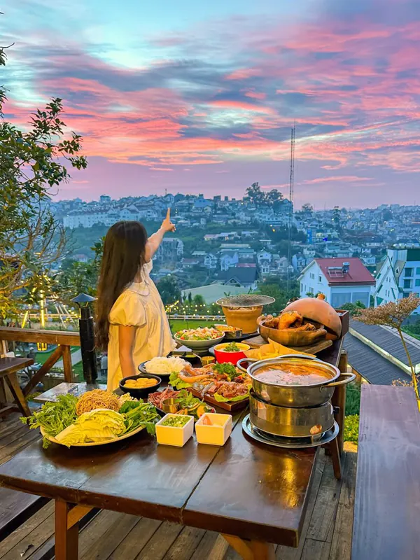

Buổi tối ở Đà Lạt lạnh hơn ban ngày khá nhiều, nên món hợp nhất là món nóng và ăn chậm được: **nướng than tại bàn** và **lẩu**. Dưới đây là cách xếp một bữa tối ấm bụng ở Trạm Nắng BBQ & More, kèm giá từng món.

## Bốn nhóm món hợp trời lạnh

| Nhóm | Món gợi ý | Giá |
|---|---|---|
| Mở đầu cho ấm | Súp gà nấm | 60.000đ |
| | Súp Tom Yum hải sản | 140.000đ |
| Nướng tại bàn | Bò tảng sốt trứng muối | 189.000đ |
| | Chẳng dừng heo | 89.000đ |
| Lẩu | Lẩu gà lá é | 250.000đ |
| | Lẩu cá tầm | 360.000đ |
| Đồ uống nóng | Trà cam quế, trà gừng táo đỏ | 45.000đ |

## Thứ tự gọi món cho một bữa tối

1. **Súp nóng** trong lúc chờ nhóm bếp.
2. **Món nướng** khi trời còn sáng, vừa nướng vừa ngắm hoàng hôn.
3. **Lẩu** khi trời đã tối và lạnh hẳn.
4. **Trà nóng** để kết bữa.

## Thực đơn gợi ý

| Nhóm | Món | Tạm tính |
|---|---|---|
| 2 người | Súp gà nấm + chẳng dừng heo + lẩu gà lá é + 2 trà nóng | 489.000đ |
| 4 người | Súp Tom Yum hải sản + bò tảng sốt trứng muối + nầm nướng chao + lẩu cá tầm + cơm chiên tỏi trứng | 887.000đ |

*Giá cộng từ thực đơn. Dòng 4 người chưa gồm đồ uống.*

## Ngồi đâu cho đỡ lạnh?

- **Sàn gỗ và sân cỏ:** ngồi gần bếp than sẽ ấm hơn bạn nghĩ, nhưng vẫn cần áo khoác.
- **Khu trong nhà:** dành cho hôm quá lạnh hoặc có mưa.

Xem bài [ngồi khu nào ở Trạm Nắng](/blog/ngoi-khu-nao-o-tram-nang-san-go-san-co-trong-nha/) và đủ món ở trang [Thực đơn](/thuc-don/).

**Trạm Nắng BBQ & More**: 18 Đống Đa, phường Xuân Hương - Đà Lạt · Mở cửa 15h – 22h (order cuối 21h30) · Đặt bàn: [0865 751 768](tel:0865751768)
