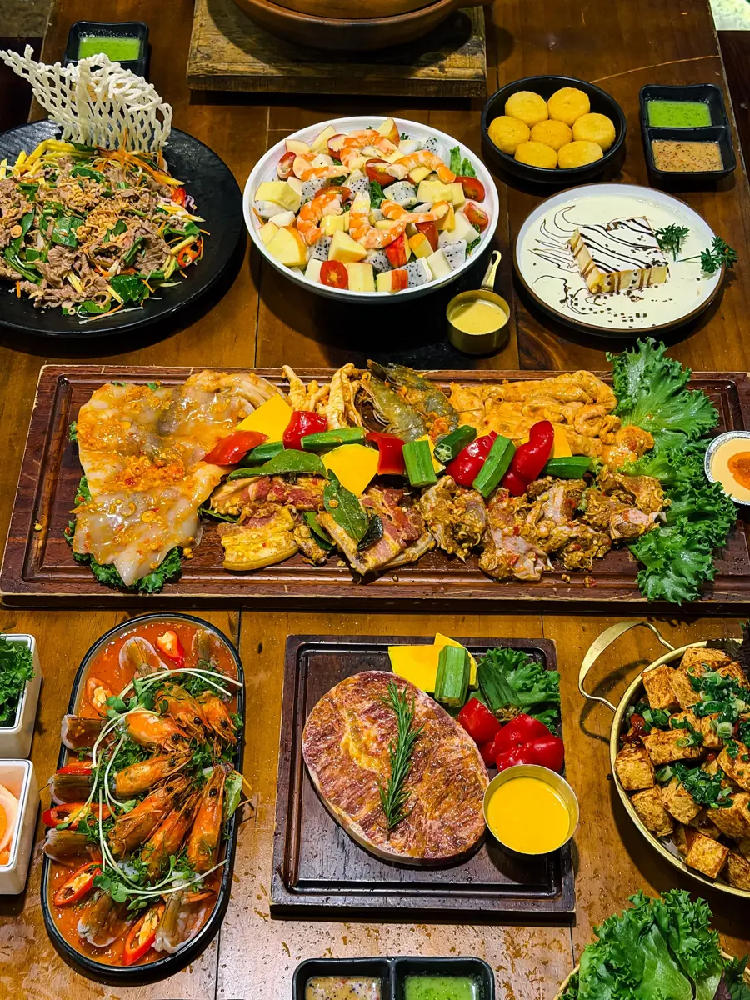
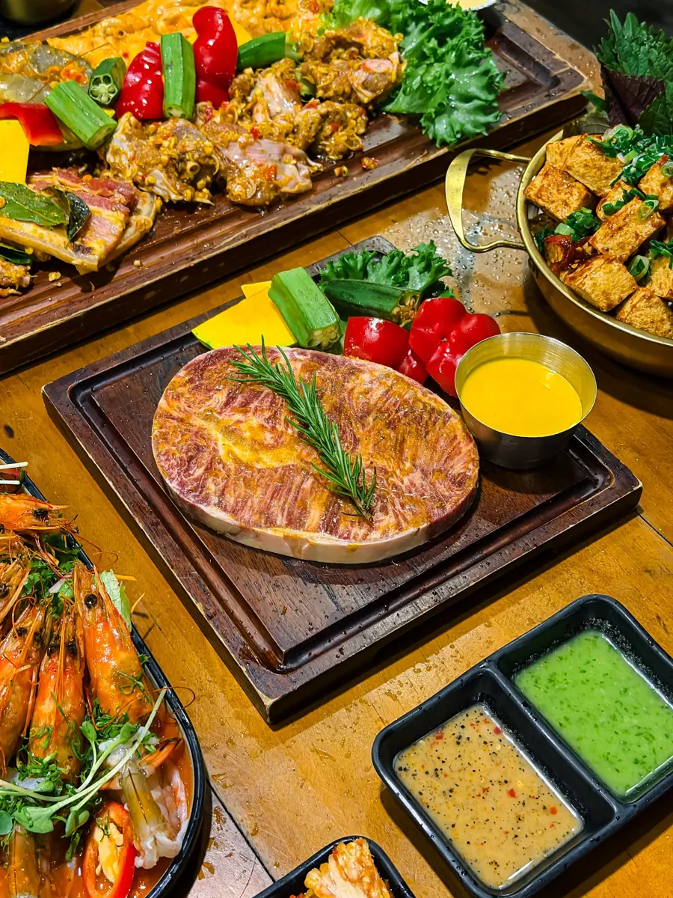
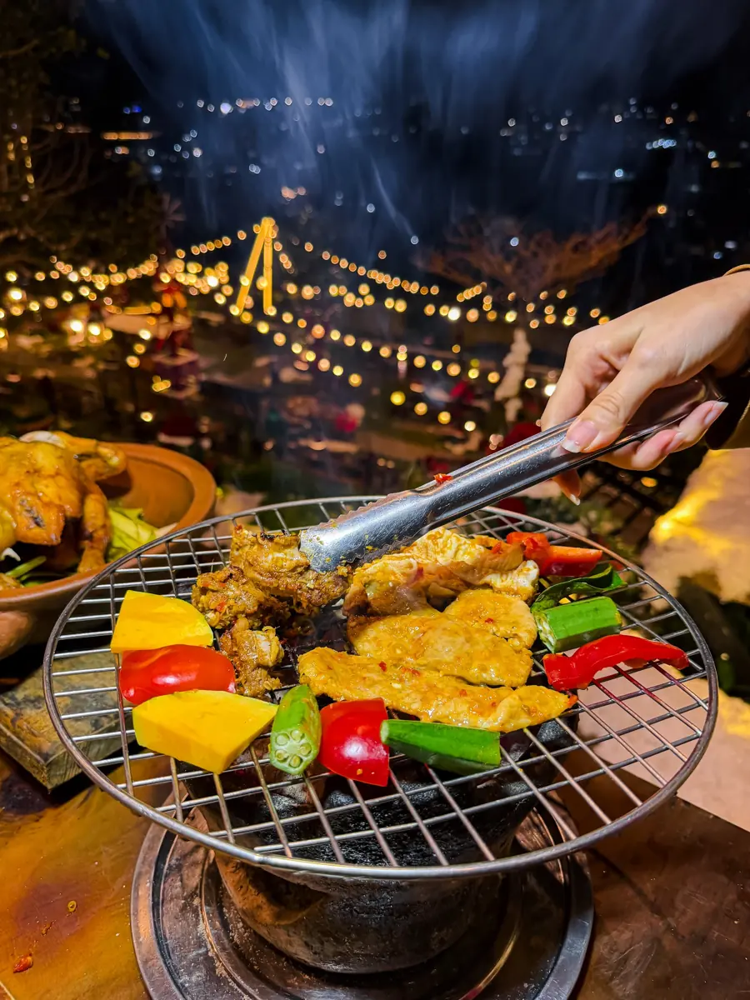

Thực đơn Trạm Nắng có hơn 50 món, từ nướng tại bàn, lẩu đến món ăn chơi. Lần đầu ghé mà không biết bắt đầu từ đâu thì đây là những món khách gọi nhiều nhất, kèm cách gọi vừa đủ cho từng nhóm.

## 1. Combo nướng – 390.000đ

Món dễ chọn nhất cho nhóm 2–3 người. Một khay gỗ lớn gồm gà, sườn, tôm, đậu bắp, ớt chuông và khoai tây chiên, nướng sẵn mang ra. Gọi món này trước, rồi thêm món nướng tại bàn nếu còn đói.

## 2. Gà Kampot – 350.000đ

Gà nguyên con đựng trong niêu đất có nắp, là một trong hai món **best seller** ở nhóm Signature. Một con đủ cho 3–4 người ăn kèm món khác.

## 3. Sườn tảng đút lò – 369.000đ

Nguyên tảng sườn heo nướng lò chậm, ăn kèm khoai tây chiên và bắp. Hợp với nhóm thích món "ra mắt" để chụp hình.

## 4. Bò tảng sốt trứng muối – 189.000đ

Món nướng tại bàn được gọi nhiều nhất. Bò tảng mang ra cùng chén sốt trứng muối, tự nướng trên bếp than ngay tại bàn.

## 5. Lẩu cá tầm – 360.000đ hoặc lẩu gà lá é – 250.000đ

Trời Đà Lạt về đêm lạnh, nồi lẩu nóng gần như bàn nào cũng gọi. **Cá tầm** là đặc sản vùng cao, còn **gà lá é** thơm mùi lá é, dễ ăn với mọi người.

## 6. Món ăn chơi trong lúc chờ nướng

- **Đậu hũ tắm sốt cay** – 89.000đ (best seller)
- **Sứa sốt Namjim** – 89.000đ (best seller)
- **Khoai lang phô mai trứng muối** – 59.000đ (best seller)
- **Tôm tái sốt Thái** – 169.000đ
- **Chẳng dừng heo nướng** – 89.000đ (best seller)

## Gợi ý gọi món theo số người

| Nhóm | Gợi ý | Tạm tính |
|---|---|---|
| 2 người | Combo nướng + khoai lang phô mai trứng muối + 2 soda | 539.000đ |
| 4 người | Combo nướng + lẩu gà lá é + bò tảng sốt trứng muối + đậu hũ tắm sốt cay | 918.000đ |
| 6 người | Gà Kampot + sườn tảng đút lò + lẩu cá tầm + chẳng dừng heo + nầm nướng chao + cơm chiên tỏi trứng | 1.366.000đ |

*Tạm tính theo giá trên thực đơn, chưa gồm đồ uống trừ khi ghi rõ.*

Xem đầy đủ giá từng món ở trang [Thực đơn](/thuc-don/). Nhóm đông muốn chuẩn bị món trước, nhắn quán qua Zalo **0865 751 768** để được tư vấn.

**Trạm Nắng BBQ & More**: 18 Đống Đa, phường Xuân Hương - Đà Lạt · [Xem đường đi trên Google Maps](https://www.google.com/maps/place/tr%E1%BA%A1m+n%E1%BA%AFng/data=!4m2!3m1!1s0x31711344fbf5174d:0xfd28f063bc80da8c) · Mở cửa 15h – 22h (order cuối 21h30) · Đặt bàn: [0865 751 768](tel:0865751768)
