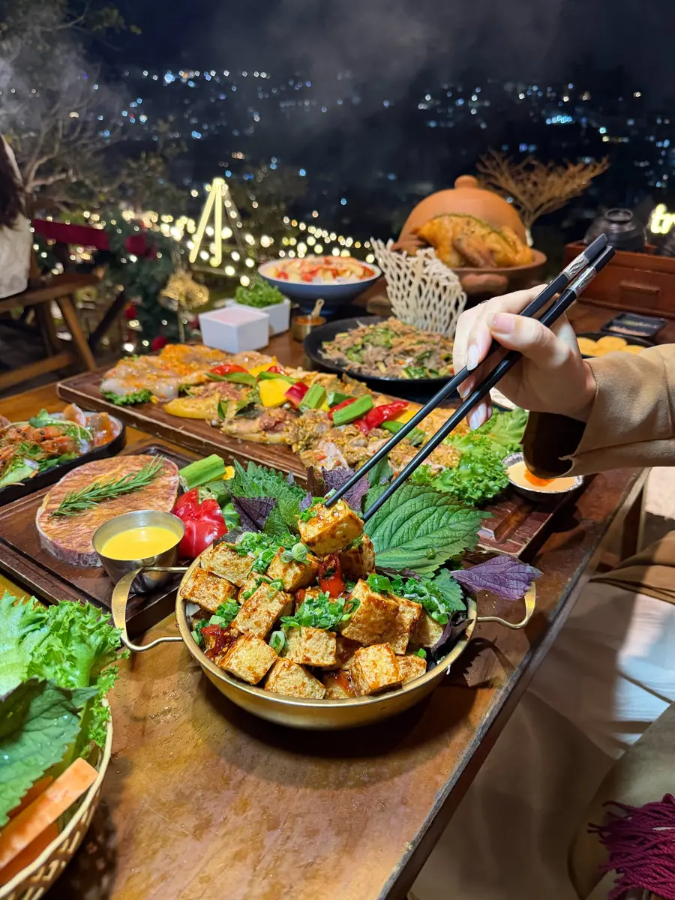
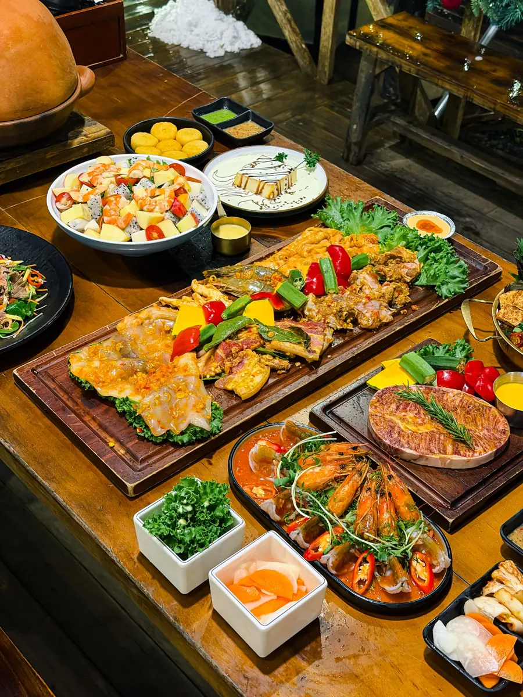

Nướng tại bàn là kiểu ăn hợp nhất với trời Đà Lạt: bếp than hồng ngay trước mặt, thịt chín tới đâu ăn tới đó. **Trạm Nắng BBQ & More** có 12 món nướng tại bàn, giá từ 79.000đ đến 189.000đ một phần.

## Bảng giá 12 món nướng tại bàn

| Món | Giá |
|---|---|
| Bò tảng sốt trứng muối | 189.000đ |
| Bò nướng hít hà | 189.000đ |
| Cá tầm nướng | 160.000đ |
| Mực nướng sa tế bùng vị | 139.000đ |
| Heo rừng lai nướng mắc mật | 129.000đ |
| Ba chỉ bò | 129.000đ |
| Tôm nướng muối ớt | 129.000đ |
| Nọng má heo nướng | 119.000đ |
| Nầm nướng chao | 109.000đ |
| Chẳng dừng heo | 89.000đ |
| Ba chỉ heo | 89.000đ |
| Chân gà rút xương | 79.000đ |

Gọi thêm kim chi: 30.000đ. Các món gắn nhãn best seller là bò tảng sốt trứng muối, nầm nướng chao và chẳng dừng heo.

## Gọi bao nhiêu món là đủ?

Mỗi người ước chừng cần 1–2 phần nướng, cộng thêm món nước hoặc cơm.

| Nhóm | Gợi ý | Tạm tính |
|---|---|---|
| 2 người | Bò tảng sốt trứng muối + chẳng dừng heo + tôm nướng muối ớt + cơm chiên tỏi trứng | 496.000đ |
| 4 người | Combo nướng + bò nướng hít hà + nầm nướng chao + lẩu gà lá é | 938.000đ |
| 6 người | Combo nướng + bò tảng sốt trứng muối + mực nướng sa tế + ba chỉ heo + nọng má heo + lẩu cá tầm | 1.286.000đ |

*Giá cộng từ thực đơn, chưa gồm đồ uống.*

## Không muốn tự chọn từng món?

Gọi **combo nướng** (390.000đ) cho 2–3 người: một khay có sẵn gà, sườn, tôm và rau củ. Sau đó thêm một hai món nướng tại bàn nếu còn đói.

## Mẹo nướng ngon

1. Nướng món nhạt trước, món ướp đậm sau, để vỉ không bị khét sớm.
2. Đừng xếp kín vỉ, thịt sẽ ra nước thay vì xém cạnh.
3. Hải sản chín nhanh, nướng sau cùng và ăn ngay.

Xem đủ món ở trang [Thực đơn](/thuc-don/#bbq).

**Trạm Nắng BBQ & More**: 18 Đống Đa, phường Xuân Hương - Đà Lạt · Mở cửa 15h – 22h (order cuối 21h30) · Đặt bàn: [0865 751 768](tel:0865751768)
