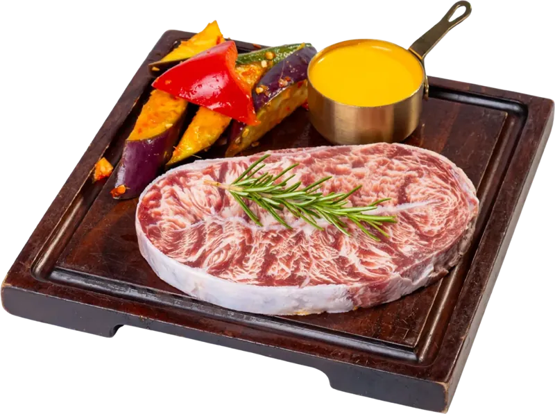
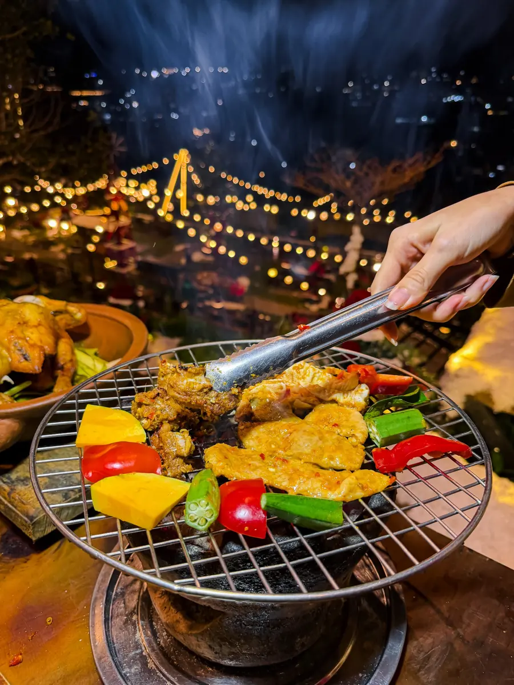

Ở **Trạm Nắng BBQ & More**, bò nướng là món tự nướng tại bàn trên bếp than. Thực đơn có ba món bò nướng, trong đó **bò tảng sốt trứng muối** (189.000đ) là món best seller của nhóm BBQ tại bàn.

## Ba món bò nướng ở Trạm Nắng

| Món | Giá | Điểm riêng |
|---|---|---|
| Bò tảng sốt trứng muối | 189.000đ | Best seller, chấm sốt trứng muối |
| Bò nướng hít hà | 189.000đ | Ăn với sốt mù tạt |
| Ba chỉ bò | 129.000đ | Thịt có lớp mỡ xen, giá mềm hơn |

## Nướng tại bàn là thế nào?

Quán mang bếp than và vỉ nướng ra bàn. Bạn tự nướng theo độ chín mình thích, ăn tới đâu nướng tới đó nên thịt luôn nóng.

## Gọi bò thì nên thêm gì?

- **Thêm món nướng khác vị:** chẳng dừng heo (89.000đ), tôm nướng muối ớt (129.000đ).
- **Thêm rau:** salad dầu giấm (79.000đ), rau củ kho quẹt (89.000đ).
- **Thêm tinh bột:** cơm chiên tỏi trứng (89.000đ).
- **Thêm món nước:** lẩu gà lá é (250.000đ).

## Hai người thích bò gọi thế nào?

Gợi ý: bò tảng sốt trứng muối + ba chỉ bò + salad dầu giấm + cơm chiên tỏi trứng, tạm tính **486.000đ** chưa gồm đồ uống.

## Muốn món bò không cần nướng?

Quán có **gỏi bò ngũ sắc** (169.000đ) trong nhóm món ăn chơi và **mì xào bò** (110.000đ) trong nhóm cơm, mì.

Xem đủ món ở trang [Thực đơn](/thuc-don/#bbq).

**Trạm Nắng BBQ & More**: 18 Đống Đa, phường Xuân Hương - Đà Lạt · Mở cửa 15h – 22h (order cuối 21h30) · Đặt bàn: [0865 751 768](tel:0865751768)
