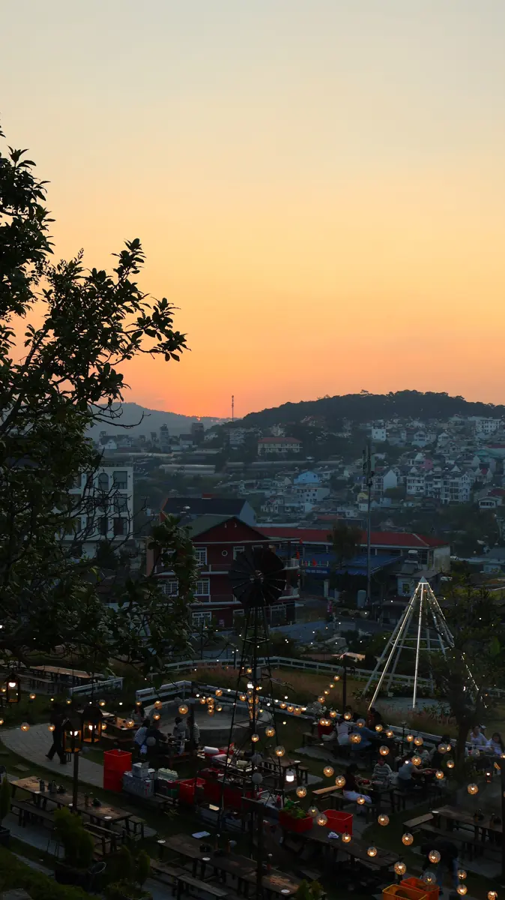

Buổi tối ở Đà Lạt ngắn hơn nhiều người nghĩ: trời tối sớm và lạnh nhanh. Lịch gọn nhất là gom ba việc vào một khu gần trung tâm: **ngắm hoàng hôn, ăn tối, rồi dạo phố đêm**.

## Lịch trình gợi ý

| Giờ | Hoạt động | Ghi chú |
|---|---|---|
| 16h30 – 17h | Đến quán có view, chọn bàn | Đến trước hoàng hôn khoảng 45 phút |
| 17h – 18h | Ngắm hoàng hôn, gọi món nướng | Giờ hoàng hôn khoảng 17h20 – 18h20 tùy mùa |
| 18h – 19h30 | Ăn tối, ngắm phố lên đèn | Gọi thêm lẩu khi trời lạnh |
| 19h30 – 22h | Dạo khu trung tâm, chợ đêm, quanh hồ | Mang áo khoác |

## Chặng 1: ngắm hoàng hôn và ăn tối một chỗ

Chọn một quán vừa có view vừa ăn tối được thì bạn không phải di chuyển giữa hai chặng. **Trạm Nắng BBQ & More** ở 18 Đống Đa mở từ 15h, sàn gỗ nhìn ra thành phố và tháp Vinaphone.

Thực đơn gợi ý cho 2 người: combo nướng + khoai lang phô mai trứng muối + 2 soda, tạm tính **539.000đ**. Nhóm 4 người: combo nướng + lẩu gà lá é + bò tảng sốt trứng muối + đậu hũ tắm sốt cay, tạm tính **918.000đ** chưa gồm đồ uống.

## Chặng 2: dạo phố đêm

Sau bữa tối, khu trung tâm là nơi đông vui nhất: khu chợ đêm, quảng trường và đường quanh hồ Xuân Hương. Quán gần trung tâm nên đi tiếp khá tiện.

## Tối thứ Bảy có gì thêm?

Ở Trạm Nắng, acoustic thường diễn vào tối thứ Bảy hằng tuần, lịch thay đổi theo tháng. Nếu thích nghe nhạc, bạn có thể ngồi lại quán thay vì đi chặng 2. Xem bài [đêm acoustic ở Trạm Nắng](/blog/dem-acoustic-o-tram-nang-da-lat/).

## Nếu trời mưa?

- Ăn tối ở khu trong nhà của quán.
- Chờ tạnh rồi mới dạo phố. Mưa chiều tối ở Đà Lạt thường không kéo dài cả đêm.

## Lưu ý cho buổi tối

1. **Áo khoác** là bắt buộc.
2. **Đặt bàn trước** vào cuối tuần.
3. **Quán nhận order cuối lúc 21h30**, nên đừng đến quá muộn.

Xem thêm bài [quán ăn view đẹp Đà Lạt buổi tối](/blog/quan-an-view-dep-da-lat-buoi-toi/) và trang [Thực đơn](/thuc-don/).

**Trạm Nắng BBQ & More**: 18 Đống Đa, phường Xuân Hương - Đà Lạt · Mở cửa 15h – 22h (order cuối 21h30) · Đặt bàn: [0865 751 768](tel:0865751768)
