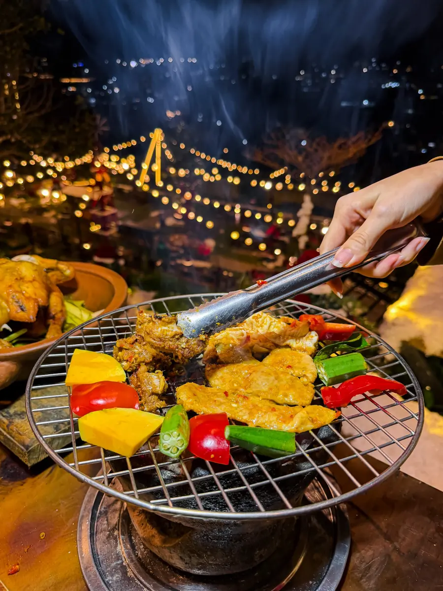

Ngoài bò và ba chỉ quen thuộc, thực đơn nướng tại bàn của **Trạm Nắng BBQ & More** có hai món mang vị vùng cao: **cá tầm nướng** (160.000đ) và **heo rừng lai nướng mắc mật** (129.000đ). Cả hai đều tự nướng trên bếp than ngay tại bàn.

## Cá tầm nướng – 160.000đ

Cá tầm là loại cá nước lạnh, được nuôi ở vùng núi cao như Lâm Đồng. Ở quán, cá tầm có hai cách ăn:

| Món | Giá | Kiểu ăn |
|---|---|---|
| Cá tầm nướng | 160.000đ | Tự nướng tại bàn |
| Lẩu cá tầm | 360.000đ | Nồi lẩu cho cả bàn |

Cá chín nhanh hơn thịt, nên nướng vừa tới và ăn ngay khi còn nóng.

## Heo rừng lai nướng mắc mật – 129.000đ

Mắc mật là loại lá gia vị quen thuộc ở vùng núi phía Bắc, hay dùng để ướp các món nướng và quay. Món này hợp với người thích thịt có mùi thơm của lá rừng.

## Nướng hai món này thế nào cho ngon?

1. **Cá nướng riêng lượt.** Đừng nướng chung với thịt ướp đậm, cá dễ bị ám mùi.
2. **Heo rừng nướng lửa vừa.** Trở đều tay để thịt chín mà không khô.
3. **Ăn kèm rau.** Gọi thêm rau củ kho quẹt (89.000đ) hoặc salad dầu giấm (79.000đ) cho đỡ ngấy.

## Gợi ý một bàn 4 người

Cá tầm nướng + heo rừng lai nướng mắc mật + bò tảng sốt trứng muối + lẩu gà lá é + cơm chiên tỏi trứng, tạm tính **817.000đ** chưa gồm đồ uống.

## Các món nướng khác đáng thử

- **Nầm nướng chao** (109.000đ), best seller.
- **Chẳng dừng heo** (89.000đ), best seller.
- **Mực nướng sa tế bùng vị** (139.000đ) cho người ăn cay.

Xem bảng giá đủ 12 món nướng ở trang [Thực đơn](/thuc-don/#bbq).

**Trạm Nắng BBQ & More**: 18 Đống Đa, phường Xuân Hương - Đà Lạt · Mở cửa 15h – 22h (order cuối 21h30) · Đặt bàn: [0865 751 768](tel:0865751768)
