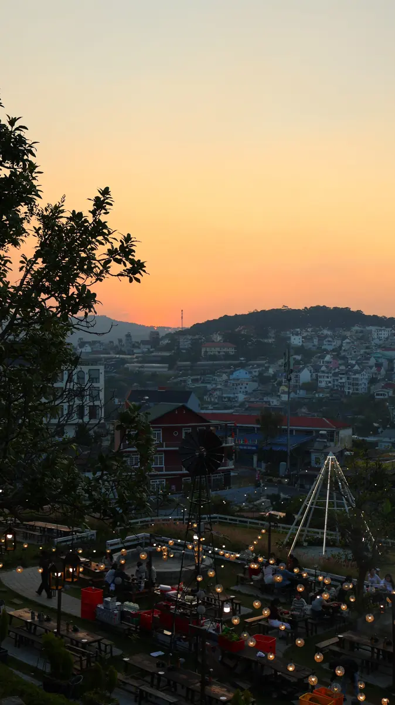
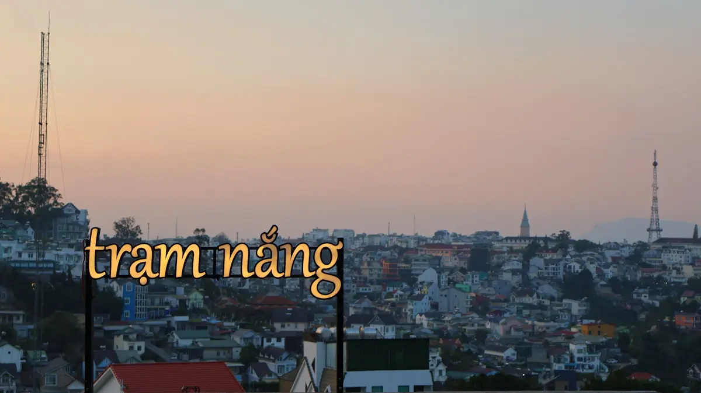

Bạn không cần chạy xe ra ngoại ô để ngắm hoàng hôn Đà Lạt. Ở khu gần trung tâm, chỉ cần một chỗ trên cao, tầm nhìn thoáng về phía thành phố là đủ. Sàn gỗ của **Trạm Nắng BBQ & More** ở 18 Đống Đa là một chỗ như vậy, và bạn ngồi ăn tối luôn được.

## Vì sao ngắm hoàng hôn gần trung tâm tiện hơn?

- **Đỡ thời gian đi lại.** Ngắm xong là ở sẵn trong phố.
- **Có cảnh thành phố.** Hoàng hôn trên các mái nhà và tháp Vinaphone khác hẳn hoàng hôn trên đồi trống.
- **Không lo đường về lúc tối.**

## Hoàng hôn ở Trạm Nắng trông thế nào?

Trời chuyển từ vàng cam sang hồng tím phía trên các đồi nhà. Khi trời tối dần, sân cỏ bên dưới bắt đầu sáng đèn dây.

## Nên đến lúc mấy giờ?

| Mùa | Mặt trời lặn khoảng | Nên có mặt |
|---|---|---|
| Tháng 11 – tháng 1 | 17h20 – 17h40 | 16h30 – 16h45 |
| Tháng 2 – tháng 4 | 17h40 – 18h00 | 17h00 |
| Tháng 5 – tháng 8 | 18h00 – 18h20 | 17h15 – 17h30 |
| Tháng 9 – tháng 10 | 17h30 – 17h50 | 16h45 |

Giờ trong bảng là khoảng chừng. Trên [trang chủ](/) có hộp thời tiết hiện giờ hoàng hôn của đúng hôm nay.

## Ngắm hoàng hôn thì ngồi khu nào?

Chọn **sàn gỗ ngắm phố**, bàn sát lan can. Khi đặt bàn, bạn nói rõ muốn ngồi khu này. Xem so sánh ba khu ở bài [ngồi khu nào ở Trạm Nắng](/blog/ngoi-khu-nao-o-tram-nang-san-go-san-co-trong-nha/).

## Gọi gì trong lúc chờ trời đổi màu?

Gọi món nướng trước để kịp nhóm bếp: combo nướng cho 2–3 người (390.000đ), thêm đậu hũ tắm sốt cay (89.000đ) ăn chơi. Trời tối thì gọi thêm lẩu. Xem trang [Thực đơn](/thuc-don/).

**Trạm Nắng BBQ & More**: 18 Đống Đa, phường Xuân Hương - Đà Lạt · Mở cửa 15h – 22h (order cuối 21h30) · Đặt bàn: [0865 751 768](tel:0865751768)
