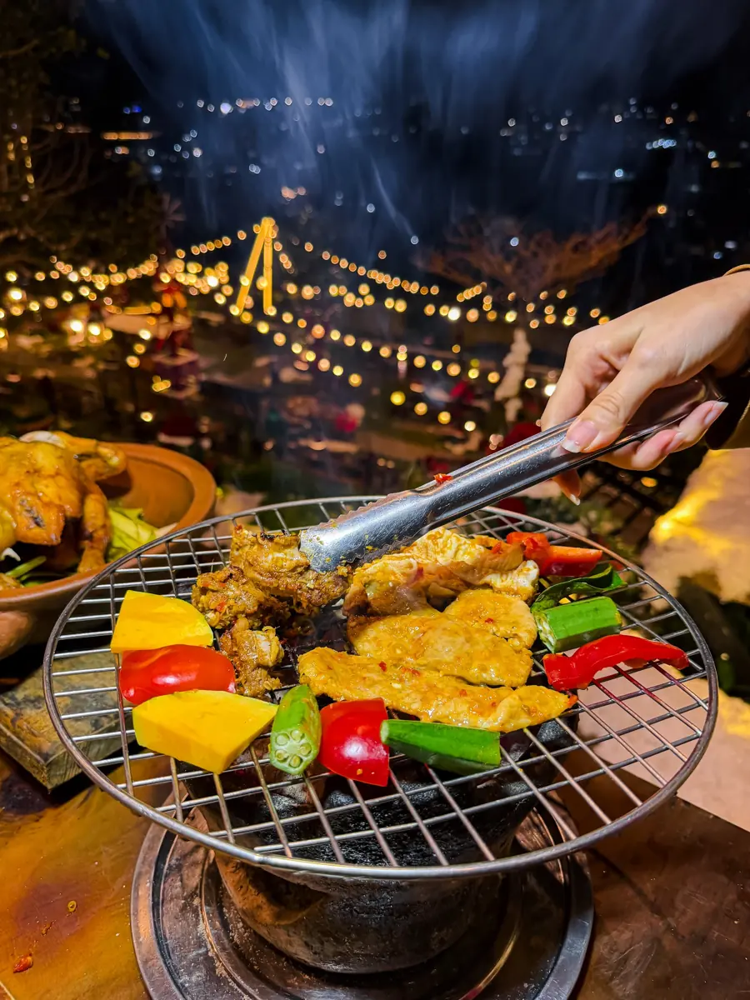

Đi Đà Lạt 3 ngày 2 đêm, bạn có khoảng 7 bữa chính. Cách xếp dễ nhất là: **bữa sáng ăn món địa phương nhẹ bụng, bữa trưa ăn nhanh gần điểm chơi, hai bữa tối dành cho lẩu và nướng**.

## Lịch ăn gợi ý

| Bữa | Món nên thử | Ghi chú |
|---|---|---|
| Tối ngày 1 | Nướng than tại bàn, ngắm hoàng hôn | Bữa "ra mắt" Đà Lạt |
| Sáng ngày 2 | Bánh căn | Ăn nóng, hợp sáng lạnh |
| Trưa ngày 2 | Cơm hoặc bún gần điểm tham quan | Ăn gọn để đi tiếp |
| Tối ngày 2 | Lẩu gà lá é hoặc lẩu cá tầm | Hợp trời tối lạnh |
| Sáng ngày 3 | Bánh mì xíu mại | Món sáng quen thuộc |
| Trưa ngày 3 | Ăn nhẹ, mua quà | Trước khi về |
| Ăn vặt buổi tối | Bánh tráng nướng, sữa đậu nành nóng | Quanh khu chợ đêm |

## Bữa tối ngày 1: nướng than ngắm hoàng hôn

Bữa đầu tiên nên là bữa có cảnh. Ở **Trạm Nắng BBQ & More** (18 Đống Đa, gần trung tâm), bạn ngồi sàn gỗ nhìn ra thành phố và tháp Vinaphone, nướng tại bàn trên bếp than.

Gợi ý cho 4 người: combo nướng + bò tảng sốt trứng muối + đậu hũ tắm sốt cay + cơm chiên tỏi trứng, tạm tính **757.000đ** chưa gồm đồ uống.

## Bữa tối ngày 2: lẩu

Nếu thích không gian của bữa đầu, bạn có thể quay lại để ăn lẩu: lẩu gà lá é (250.000đ) hoặc lẩu cá tầm (360.000đ), thêm gà Kampot nguyên con (350.000đ) cho nhóm đông. Hoặc chọn một quán lẩu khác trong phố để đổi vị.

## Mẹo xếp lịch ăn

1. **Bữa có view để vào buổi chiều tối**, đến trước hoàng hôn khoảng 45 phút.
2. **Đặt bàn trước** cho hai bữa tối, nhất là cuối tuần.
3. **Buổi sáng ăn sớm**, nhiều quán ăn sáng địa phương hết món khá nhanh.
4. **Mang áo khoác** cho mọi bữa tối.

## Chi phí bữa tối ở quán nướng

Theo giá thực đơn Trạm Nắng, bữa tối rơi vào khoảng 230.000đ – 330.000đ mỗi người tùy cách gọi. Xem bảng tính ở bài [ăn tối Đà Lạt 2 người hết bao nhiêu tiền](/blog/an-toi-da-lat-2-nguoi-het-bao-nhieu-tien/).

Xem thêm trang [Thực đơn](/thuc-don/) và bài [buổi tối ở Đà Lạt đi đâu](/blog/buoi-toi-o-da-lat-di-dau/).

**Trạm Nắng BBQ & More**: 18 Đống Đa, phường Xuân Hương - Đà Lạt · Mở cửa 15h – 22h (order cuối 21h30) · Đặt bàn: [0865 751 768](tel:0865751768)
