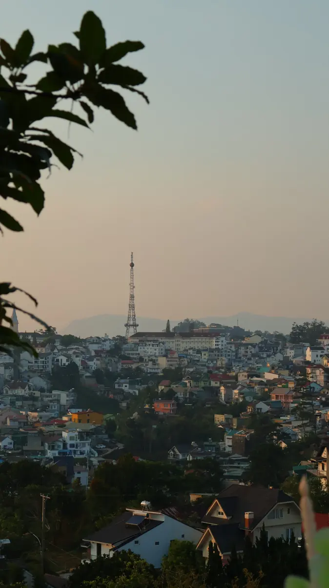

Tháng 12 là một trong những tháng đẹp nhất để lên Đà Lạt: trời khô, ít mưa, lạnh rõ và có không khí Giáng sinh. Điểm cần nhớ là trời tối sớm, nên lịch buổi chiều phải gọn.

## Tháng 12 ở Đà Lạt có gì?

| Điểm nổi bật | Mô tả |
|---|---|
| Thời tiết | Mùa khô, trời trong, ít mưa hơn các tháng giữa năm |
| Nhiệt độ | Ban ngày mát, đêm lạnh, cần áo khoác dày |
| Hoàng hôn | Sớm, khoảng 17h20 – 17h40 |
| Không khí | Nhiều nơi trang trí Giáng sinh và đón năm mới |

Thời tiết mỗi năm một khác, bạn nên xem dự báo trước khi đi.

## Vì sao hoàng hôn tháng 12 đáng chờ?

Mùa khô trời trong, nên nhiều chiều có hoàng hôn rõ màu. Vì mặt trời lặn sớm, bạn nên có mặt ở chỗ ngắm từ khoảng 16h30.

## Một buổi chiều tối tháng 12 gợi ý

| Giờ | Làm gì |
|---|---|
| 15h – 16h30 | Dạo quanh khu trung tâm |
| 16h30 | Đến quán có view, chọn bàn, gọi món nướng |
| 17h20 – 18h | Ngắm hoàng hôn và lúc phố lên đèn |
| Sau 18h30 | Ăn lẩu, uống trà nóng |

## Ăn tối ở đâu để kịp hoàng hôn?

**Trạm Nắng BBQ & More** ở 18 Đống Đa, gần trung tâm, mở từ 15h. Sàn gỗ của quán nhìn ra thành phố và tháp Vinaphone. Từ tháng 11, sân cỏ được trang trí Giáng sinh.

Món hợp trời tháng 12:

- Lẩu gà lá é (250.000đ), lẩu cá tầm (360.000đ).
- Nướng tại bàn: bò tảng sốt trứng muối (189.000đ), chẳng dừng heo (89.000đ).
- Trà nóng cam quế, gừng táo đỏ (45.000đ).

## Lưu ý khi đi Đà Lạt tháng 12

1. **Mang đủ áo ấm.** Buổi tối ngoài trời lạnh hơn bạn nghĩ.
2. **Đặt chỗ sớm.** Cuối tháng 12 là mùa cao điểm.
3. **Xếp lịch chiều gọn** vì 18h trời đã tối.

Xem thêm bài [Trạm Nắng trang trí Noel](/blog/tram-nang-trang-tri-noel-tu-thang-11/) và [đi giờ nào để kịp hoàng hôn](/blog/quan-nuong-view-hoang-hon-da-lat-di-gio-nao/).

**Trạm Nắng BBQ & More**: 18 Đống Đa, phường Xuân Hương - Đà Lạt · Mở cửa 15h – 22h (order cuối 21h30) · Đặt bàn: [0865 751 768](tel:0865751768)
