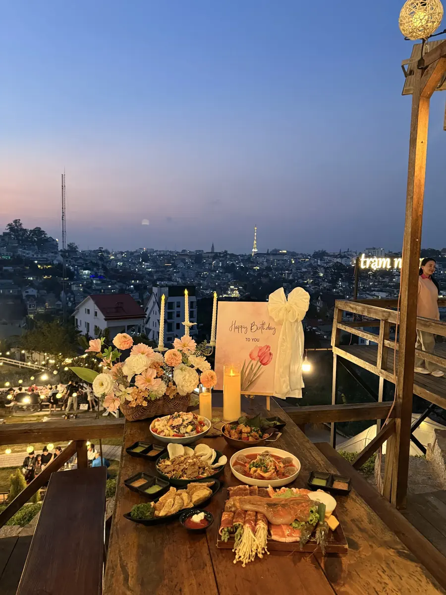

Tháng 12 ở Đà Lạt, ban ngày trời mát và có nắng, nhưng từ chiều tối nhiệt độ xuống nhanh. Nguyên tắc dễ nhớ là **mặc nhiều lớp**: ban ngày cởi bớt, tối mặc thêm.

## Mặc gì theo từng buổi?

| Buổi | Thời tiết thường gặp | Nên mặc |
|---|---|---|
| Sáng sớm | Lạnh, có sương | Áo khoác, khăn mỏng |
| Trưa, đầu chiều | Mát, có nắng | Áo dài tay, áo khoác mỏng cầm theo |
| Chiều tối | Lạnh dần, có gió | Áo khoác dày |
| Đêm | Lạnh rõ | Áo khoác dày, khăn, giày kín, tất |

Thời tiết mỗi năm mỗi khác. Bạn nên xem dự báo vài ngày trước chuyến đi.

## Ăn tối ngoài trời thì cần thêm gì?

Ngồi ngoài trời một hai tiếng sẽ lạnh hơn lúc đang đi bộ. Khi đi ăn nướng buổi tối, bạn nên có:

1. **Áo khoác dày** hoặc áo phao mỏng.
2. **Khăn quàng** để giữ ấm cổ.
3. **Giày kín và tất**, tránh dép hở.
4. **Mũ len** nếu bạn dễ lạnh đầu.

Bếp than tại bàn và nồi lẩu giúp ấm phần phía trước, nhưng lưng và chân vẫn lạnh, nên đừng chủ quan.

## Mặc gì để lên hình đẹp?

- **Màu sáng hoặc màu ấm** (trắng, be, đỏ, nâu) nổi trên nền trời hoàng hôn và đèn vàng.
- **Áo khoác có dáng**, vì buổi tối bạn sẽ mặc nó trong hầu hết các tấm ảnh.
- Muốn chụp váy thì chụp lúc trời còn nắng, khoảng trước 17h.

## Lỡ mặc thiếu ấm thì sao?

Ở **Trạm Nắng BBQ & More**, bạn có thể chọn ngồi **khu trong nhà** thay vì sàn gỗ hay sân cỏ. Gọi thêm trà nóng cam quế hoặc gừng táo đỏ (45.000đ) và lẩu gà lá é (250.000đ) cho ấm người.

## Danh sách đồ nên bỏ vào vali

- 2 áo khoác: một mỏng, một dày
- Áo dài tay, áo len mỏng
- Khăn quàng, mũ len, tất
- Giày kín đi bộ được trên đường dốc
- Áo mưa mỏng phòng mưa bất chợt

Xem thêm bài [Đà Lạt tháng 12 có gì đẹp](/blog/da-lat-thang-12-co-gi-dep/) và [ăn gì ở Đà Lạt buổi tối trời lạnh](/blog/an-gi-o-da-lat-buoi-toi-troi-lanh/).

**Trạm Nắng BBQ & More**: 18 Đống Đa, phường Xuân Hương - Đà Lạt · Mở cửa 15h – 22h (order cuối 21h30) · Đặt bàn: [0865 751 768](tel:0865751768)
