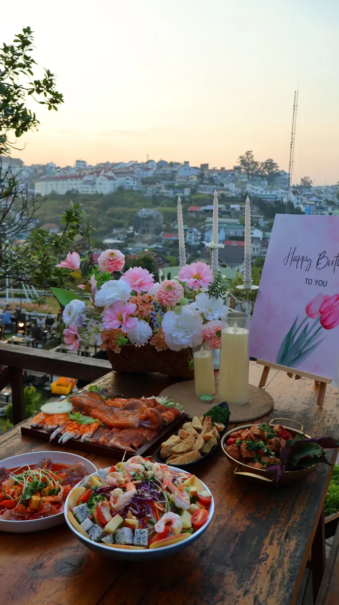
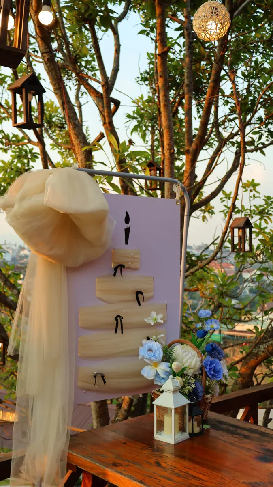
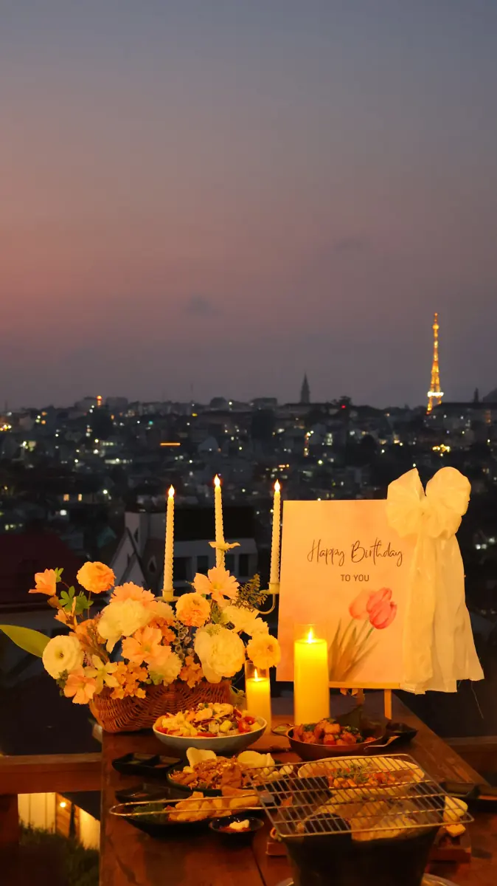

Sinh nhật ở Đà Lạt không nhất thiết phải thuê phòng riêng hay tự mang đồ đi trang trí. Ở Trạm Nắng, **quán trang trí bàn tiệc sinh nhật và kỷ niệm miễn phí**, bạn chỉ cần báo trước.

## Bàn tiệc trông như thế nào?

Bàn được dựng trên sàn gỗ ngoài trời, nhìn thẳng ra thành phố và tháp Vinaphone. Trên bàn có hoa, nến và đèn, phối theo dịp của bạn. Buổi chiều có nền trời hoàng hôn, buổi tối có đèn phố phía sau.

## Đặt tiệc trong 3 bước

1. **Nhắn quán** qua Zalo 0865 751 768: số người, ngày giờ, dịp gì và ý tưởng trang trí nếu có.
2. **Chốt decor và thực đơn.** Quán trang trí theo concept, hỗ trợ đặt bánh, hoa và gợi ý món theo số người.
3. **Đến đúng giờ.** Bàn tiệc được chuẩn bị sẵn trước khi bạn tới.

Quán trang trí theo concept của quán và có hỗ trợ đặt bánh, hoa, nên bạn chỉ cần đến trải nghiệm. Nếu muốn tự mang bánh sinh nhật, quán không tính phí và hỗ trợ dao, dĩa, ly.

## Nên chọn giờ nào?

- **Muốn ảnh đẹp nhất:** đến trước hoàng hôn khoảng 45 phút. Xem cách tính ở bài [đi giờ nào để kịp trời tím hồng](/blog/quan-nuong-view-hoang-hon-da-lat-di-gio-nao/).
- **Muốn không khí ấm cúng:** đặt sau 18h30, khi đèn dây trên sân cỏ đã sáng.

Quán mở cửa 15h – 22h, order cuối 21h30.

## Gợi ý thực đơn cho bàn tiệc

| Nhóm | Món gợi ý | Tạm tính |
|---|---|---|
| 4 người | Combo nướng, lẩu gà lá é, bò tảng sốt trứng muối, đậu hũ tắm sốt cay | 918.000đ |
| 6 người | Gà Kampot, sườn tảng đút lò, lẩu cá tầm, chẳng dừng heo, nầm nướng chao, cơm chiên tỏi trứng | 1.366.000đ |

*Giá cộng từ thực đơn, chưa gồm đồ uống.*

## Mấy điều nên nhớ

- **Báo trước càng sớm càng tốt**, nhất là cuối tuần.
- **Trời mưa không cần hủy.** Quán có khu trong nhà.
- **Đi xe riêng thoải mái.** Quán gần trung tâm và có bãi đậu xe rộng.
- **Tiệc đông người vẫn nhận.** Sức chứa của quán khoảng 800 khách.
- **Thanh toán** bằng tiền mặt hoặc chuyển khoản.

Xem thêm hình ảnh ở trang [Tiệc sinh nhật](/tiec-sinh-nhat/).

**Trạm Nắng BBQ & More**: 18 Đống Đa, phường Xuân Hương - Đà Lạt · Mở cửa 15h – 22h (order cuối 21h30) · Đặt tiệc: [0865 751 768](tel:0865751768)
