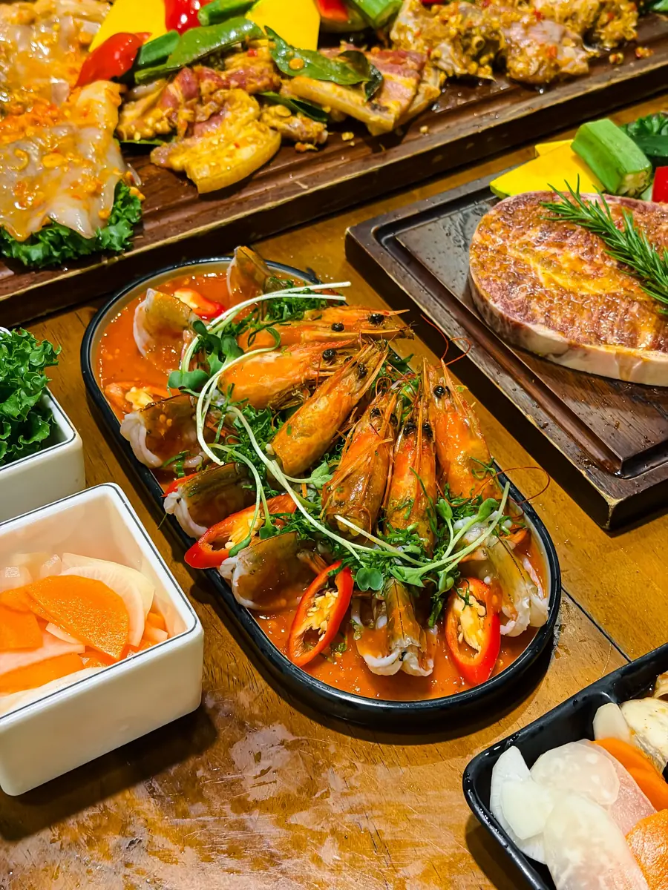

Tối Đà Lạt lạnh, ngồi lai rai với vài món ăn chơi và ly bia là kiểu nhiều nhóm bạn chọn. **Trạm Nắng BBQ & More** có 13 món ăn chơi giá từ 50.000đ, ngồi ngoài trời nhìn ra thành phố lên đèn, mở tới 22h mỗi ngày.

## 13 món ăn chơi và giá

| Món | Giá |
|---|---|
| Mực hấp chanh | 169.000đ |
| Tôm tái sốt Thái | 169.000đ |
| Gỏi bò ngũ sắc | 169.000đ |
| Chân gà sốt Thái | 99.000đ |
| Khoai tây + gà vòng lắc phô mai | 99.000đ |
| Khô heo gác bếp Tây Bắc | 99.000đ |
| Tré trộn bắt mồi | 99.000đ |
| Sứa sốt Namjim | 89.000đ |
| Đậu hũ tắm sốt cay | 89.000đ |
| Rau củ kho quẹt | 89.000đ |
| Khoai tây chiên giòn rụm | 79.000đ |
| Khoai lang phô mai trứng muối | 59.000đ |
| Đậu bắp luộc chấm chao | 50.000đ |

Các món best seller: sứa sốt Namjim, đậu hũ tắm sốt cay, khoai lang phô mai trứng muối.

## Đồ uống có cồn

| Loại | Giá |
|---|---|
| Bia Tiger Bạc (chai nhí) | 23.000đ |
| Bia Ken Bạc | 28.000đ |
| Soju | 99.000đ |
| Vodka | 120.000đ |
| Rượu nếp mới | 140.000đ |

## Gợi ý cho nhóm 4 người lai rai

Khô heo gác bếp + tré trộn bắt mồi + sứa sốt Namjim + đậu hũ tắm sốt cay + khoai tây chiên, tạm tính **455.000đ** chưa gồm đồ uống. Còn đói thì gọi thêm món nướng tại bàn hoặc một nồi lẩu.

## Mấy điều nên nhớ

- Quán nhận order cuối lúc **21h30**, đóng cửa 22h.
- Đã uống rượu bia thì không lái xe. Quán gần trung tâm, gọi xe về khá tiện.
- Ngồi ngoài trời buổi tối nên mang áo khoác.

Xem đủ món ở trang [Thực đơn](/thuc-don/#an-choi).

**Trạm Nắng BBQ & More**: 18 Đống Đa, phường Xuân Hương - Đà Lạt · Mở cửa 15h – 22h (order cuối 21h30) · Đặt bàn: [0865 751 768](tel:0865751768)
