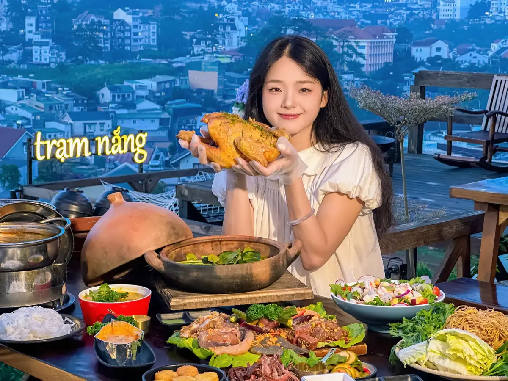

Nếu chỉ được gọi một món chính ở Trạm Nắng, nhiều bàn sẽ chọn **Gà Kampot**. Đây là một trong hai món gắn nhãn best seller của nhóm Signature, cùng với sườn tảng đút lò.

## Món này có gì đặc biệt?

- **Gà nguyên con**, da vàng óng, mang ra trong **niêu đất có nắp**.
- **Mở nắp ngay tại bàn.** Nắp niêu nhấc lên là lúc cả bàn giơ điện thoại.
- Gà đặt trên lớp lá và sả, phía trên rắc lá thái sợi.
- Giá **350.000đ** một con.

## Một con ăn mấy người?

Một con hợp với **3–4 người** khi gọi kèm món khác. Nhóm 2 người nếu gọi gà thì chỉ cần thêm một món rau hoặc cơm là đủ.

## Gọi kèm gì cho tròn bữa?

- **Thêm vị tươi:** salad tôm trái cây nhiệt đới (155.000đ) hoặc salad dầu giấm (79.000đ).
- **Thêm tinh bột:** cơm chiên tỏi trứng (89.000đ), món best seller của nhóm Cơm & Mì.
- **Thêm món nóng:** lẩu gà lá é (250.000đ) hoặc súp gà nấm (60.000đ).
- **Thêm món nướng tại bàn:** chẳng dừng heo (89.000đ), nầm nướng chao (109.000đ).

Ví dụ cho 4 người: Gà Kampot + lẩu gà lá é + cơm chiên tỏi trứng + chẳng dừng heo, tạm tính **778.000đ** chưa gồm đồ uống.

## Các món Signature khác

| Món | Giá |
|---|---|
| Sườn tảng đút lò | 369.000đ |
| Combo nướng (2–3 người) | 390.000đ |
| Lẩu cá tầm | 360.000đ |
| Lẩu gà lá é | 250.000đ |

Xem đầy đủ ở trang [Thực đơn](/thuc-don/#signature).

## Mẹo nhỏ

Nhóm đông hoặc đi giờ cao điểm cuối tuần, bạn nên nhắn quán trước để giữ bàn và báo món chính muốn gọi.

**Trạm Nắng BBQ & More**: 18 Đống Đa, phường Xuân Hương - Đà Lạt · Mở cửa 15h – 22h (order cuối 21h30) · Đặt bàn: [0865 751 768](tel:0865751768)
