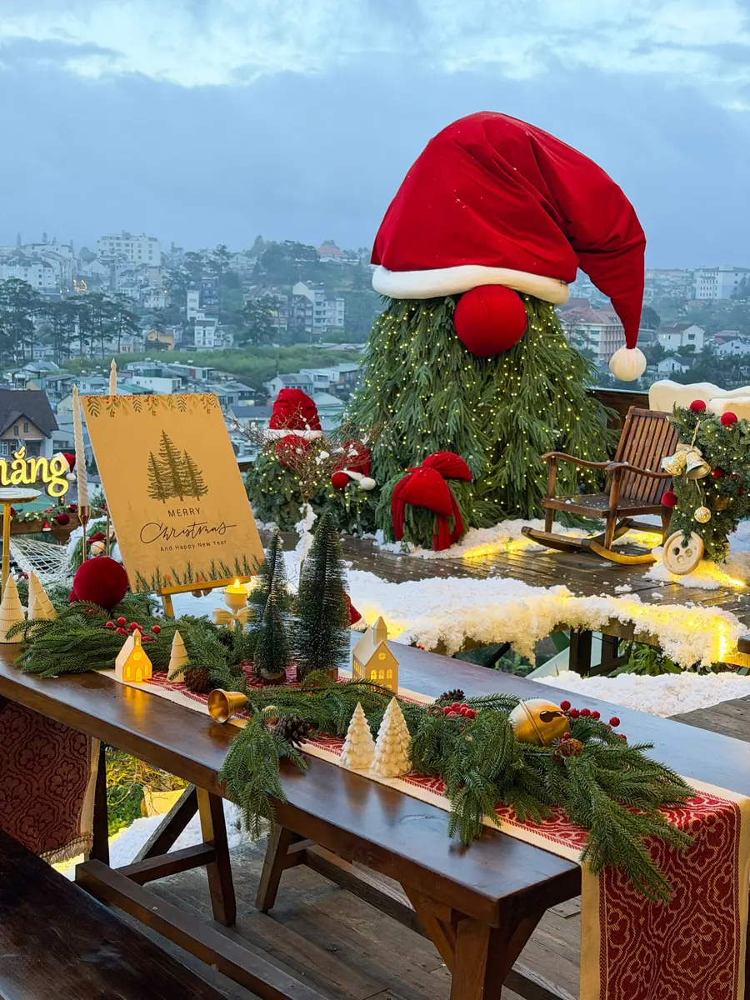
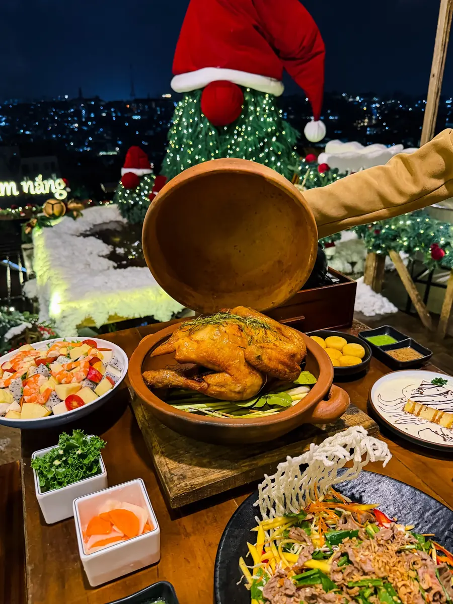

Giáng sinh ở Đà Lạt lạnh thật, nên một bữa tối quanh bếp than và nồi lẩu là lựa chọn hợp nhất. **Trạm Nắng BBQ & More** đã trang trí Noel từ tháng 11: cây thông, đèn dây, ông già Noel và tuyết nhân tạo trên sân cỏ, nhìn ra thành phố lên đèn.

## Không khí Noel ở Trạm Nắng

- **Cây thông Noel và gấu bông** giữa sân cỏ.
- **Đèn dây** giăng khắp sân, lên đèn từ chập tối.
- **Tuyết nhân tạo** trên cỏ và lối đi.
- **Bàn tiệc trang trí Noel** với cành thông và quả châu.

## Ăn gì tối Giáng sinh?

| Nhóm | Món | Tạm tính |
|---|---|---|
| 2 người | Combo nướng + lẩu gà lá é + 2 trà nóng | 730.000đ |
| 4 người | Gà Kampot + lẩu cá tầm + bò tảng sốt trứng muối + cơm chiên tỏi trứng | 988.000đ |
| 6 người | Gà Kampot + sườn tảng đút lò + lẩu cá tầm + chẳng dừng heo + nầm nướng chao + cơm chiên tỏi trứng | 1.366.000đ |

*Dòng 4 và 6 người chưa gồm đồ uống.*

**Gà Kampot** (350.000đ) là món hợp không khí lễ: gà nguyên con trong niêu đất, mở nắp ngay tại bàn.

## Đi giờ nào?

| Giờ | Cảnh |
|---|---|
| 16h30 – 17h30 | Hoàng hôn, chụp cây thông khi trời còn sáng |
| Sau 18h30 | Đèn Noel và đèn phố sáng rõ nhất |

Quán mở 15h – 22h mỗi ngày, order cuối 21h30.

## Lưu ý mùa lễ

1. **Đặt bàn sớm.** Tuần trước Giáng sinh và các tối cuối tuần tháng 12 rất đông.
2. **Mặc ấm.** Đêm tháng 12 ở Đà Lạt lạnh, cần áo khoác dày và khăn.
3. **Trời mưa** thì ngồi khu trong nhà.
4. **Đi đoàn đông** nên nhắn quán trước để ghép bàn.

Xem thêm bài [Trạm Nắng trang trí Noel từ tháng 11](/blog/tram-nang-trang-tri-noel-tu-thang-11/) và trang [Thực đơn](/thuc-don/).

**Trạm Nắng BBQ & More**: 18 Đống Đa, phường Xuân Hương - Đà Lạt · Mở cửa 15h – 22h (order cuối 21h30) · Đặt bàn: [0865 751 768](tel:0865751768)
