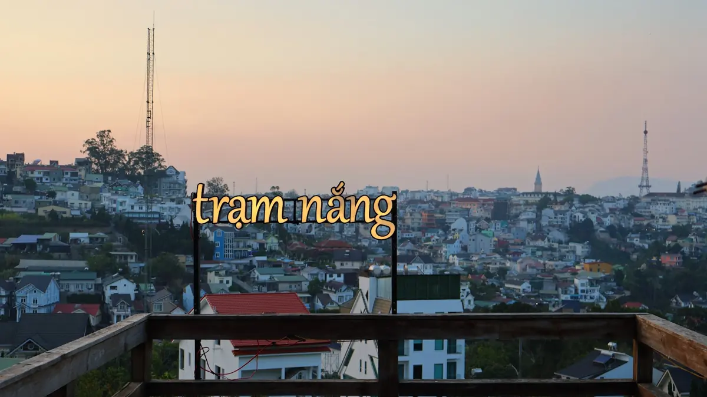

Họp lớp hay liên hoan nhóm cần chỗ ngồi được lâu, nói chuyện được và chia tiền dễ. Nướng tại bàn và lẩu ở **Trạm Nắng BBQ & More** hợp với kiểu này: mỗi bàn tự nướng, ngồi ngoài trời trên sân cỏ giăng đèn dây.

## Nhóm bao nhiêu người thì ngồi đâu?

| Số người | Khu gợi ý | Lý do |
|---|---|---|
| Dưới 10 | Sàn gỗ ngắm phố | Có view thành phố, hợp chụp ảnh |
| 10 – 30 | Sân cỏ đèn dây | Ghép được nhiều bàn liền nhau |
| Trên 30 | Sân cỏ, nhắn quán trước | Quán sắp xếp theo số khách |

Quán có sức chứa khoảng 800 khách. Trời mưa thì chuyển vào khu trong nhà.

## Cách gọi món cho đỡ rối

Chia nhóm thành các bàn 4–6 người và gọi cùng một thực đơn cho mỗi bàn. Cách này bếp ra món nhanh hơn và cuối buổi chia tiền dễ.

| Bàn | Món | Tạm tính |
|---|---|---|
| 4 người | Combo nướng + lẩu gà lá é + bò tảng sốt trứng muối + đậu hũ tắm sốt cay | 918.000đ |
| 6 người | Gà Kampot + sườn tảng đút lò + lẩu cá tầm + chẳng dừng heo + nầm nướng chao + cơm chiên tỏi trứng | 1.366.000đ |

*Giá cộng từ thực đơn, chưa gồm đồ uống.*

## Mỗi người hết khoảng bao nhiêu?

Theo hai gợi ý trên, phần đồ ăn rơi vào khoảng **230.000đ mỗi người**. Cộng thêm đồ uống: bia từ 23.000đ, nước ngọt 20.000đ, soda 45.000đ.

## Việc của người đứng ra tổ chức

1. Chốt số người trước ít nhất vài ngày.
2. Nhắn Zalo quán 0865 751 768: số người, ngày giờ, khu muốn ngồi.
3. Gửi trước thực đơn để quán chuẩn bị.
4. Nhắc mọi người mang áo khoác và giờ có mặt.

## Chụp ảnh tập thể ở đâu?

- **Sàn gỗ**, trước bảng hiệu "trạm nắng", lấy nền là thành phố.
- **Sân cỏ** lúc vừa lên đèn.

Nên chụp trước khi trời tối hẳn, khoảng 15–20 phút sau hoàng hôn. Xem bài [đi giờ nào để kịp trời tím hồng](/blog/quan-nuong-view-hoang-hon-da-lat-di-gio-nao/) và trang [Thực đơn](/thuc-don/).

**Trạm Nắng BBQ & More**: 18 Đống Đa, phường Xuân Hương - Đà Lạt · Mở cửa 15h – 22h (order cuối 21h30) · Đặt bàn: [0865 751 768](tel:0865751768)
