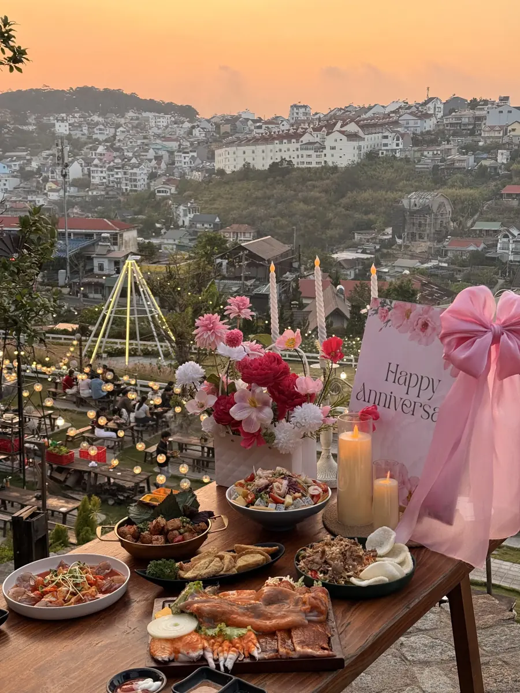

Nhiều cặp vợ chồng chọn Đà Lạt để kỷ niệm ngày cưới. Nếu bạn muốn một bữa tối có trang trí sẵn mà không cần thuê dịch vụ riêng, **Trạm Nắng BBQ & More** trang trí bàn tiệc kỷ niệm **miễn phí** theo concept của quán và hỗ trợ đặt bánh, hoa.

## Bàn tiệc kỷ niệm trông thế nào?

Bàn được dựng trên sàn gỗ ngoài trời, có hoa, nến và bảng chúc mừng. Phía sau là thành phố Đà Lạt, buổi chiều có nền trời hoàng hôn.

## Thông tin cần biết

| Mục | Chi tiết |
|---|---|
| Phí trang trí | Miễn phí, theo concept của quán |
| Bánh và hoa | Quán hỗ trợ đặt giúp |
| Giờ mở cửa | 15h – 22h mỗi ngày, order cuối 21h30 |
| Trời mưa | Chuyển bàn vào khu trong nhà |
| Đặt bàn | Zalo, điện thoại 0865 751 768 |

## Cách đặt

1. Nhắn quán trước, báo ngày giờ và đây là **kỷ niệm ngày cưới**.
2. Cho quán biết có cần đặt bánh và hoa không.
3. Chốt món. Đến nơi là bàn đã sẵn sàng.

## Thực đơn gợi ý

| Đi mấy người | Món | Tạm tính |
|---|---|---|
| Hai vợ chồng | Bò tảng sốt trứng muối + tôm nướng muối ớt + lẩu gà lá é + 2 trà nóng | 658.000đ |
| Cả nhà 4 người | Gà Kampot + lẩu cá tầm + chẳng dừng heo + cơm chiên tỏi trứng | 888.000đ |

*Giá cộng từ thực đơn. Dòng 4 người chưa gồm đồ uống.*

## Nên đến lúc nào?

Đến trước hoàng hôn khoảng 45 phút. Bạn có ảnh với nền trời đổi màu, rồi ngồi tiếp tới lúc thành phố lên đèn. Xem bảng giờ theo mùa ở bài [đi giờ nào để kịp trời tím hồng](/blog/quan-nuong-view-hoang-hon-da-lat-di-gio-nao/).

## Đi cùng con nhỏ hoặc ông bà?

Quán có sân cỏ rộng và khu trong nhà, nên kỷ niệm cùng cả gia đình cũng thoải mái. Khi đặt, bạn báo số người để quán xếp bàn phù hợp.

Xem thêm trang [Tiệc sinh nhật](/tiec-sinh-nhat/).

**Trạm Nắng BBQ & More**: 18 Đống Đa, phường Xuân Hương - Đà Lạt · Mở cửa 15h – 22h (order cuối 21h30) · Đặt bàn: [0865 751 768](tel:0865751768)
