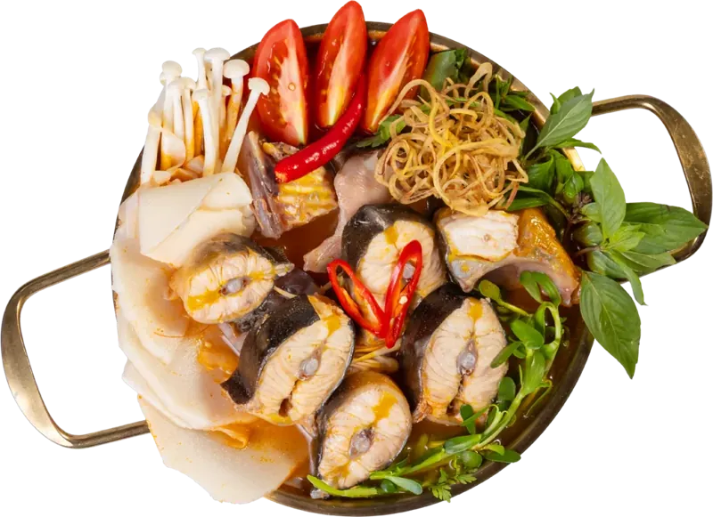

Lẩu cá tầm là món nhiều người tìm khi lên Đà Lạt, vì cá tầm là loại cá nước lạnh được nuôi ở vùng núi cao như Lâm Đồng. Ở **Trạm Nắng BBQ & More**, lẩu cá tầm giá **360.000đ** một nồi, thuộc nhóm món Signature của quán.

## Lẩu cá tầm ở Trạm Nắng

- **Giá:** 360.000đ một nồi.
- **Nhóm món:** Signature, cùng với gà Kampot, sườn tảng đút lò, combo nướng và lẩu gà lá é.
- **Hợp nhất:** buổi tối, khi trời Đà Lạt đã lạnh.

## Một nồi ăn mấy người?

Ước chừng một nồi hợp với **3–4 người** khi gọi kèm một hai món nướng. Nhóm đông hơn nên gọi thêm món nướng thay vì thêm nồi lẩu thứ hai, để bàn có cả món nướng lẫn món nước.

## Gọi kèm gì cho đủ bữa?

| Thêm gì | Món gợi ý | Giá |
|---|---|---|
| Món nướng tại bàn | Bò tảng sốt trứng muối | 189.000đ |
| Món ăn chơi | Đậu hũ tắm sốt cay | 89.000đ |
| Tinh bột | Cơm chiên tỏi trứng | 89.000đ |
| Đồ uống ấm | Trà nóng cam quế | 45.000đ |

Ví dụ cho 4 người: lẩu cá tầm + bò tảng sốt trứng muối + đậu hũ tắm sốt cay + cơm chiên tỏi trứng, tạm tính **727.000đ** chưa gồm đồ uống.

## Còn món cá tầm nào khác?

Quán có **cá tầm nướng** (160.000đ) trong nhóm BBQ tại bàn. Nhóm thích cá có thể gọi cả lẩu lẫn nướng.

## So với lẩu gà lá é

| Món | Giá | Hợp với |
|---|---|---|
| Lẩu cá tầm | 360.000đ | Người thích cá, muốn thử đặc sản vùng cao |
| Lẩu gà lá é | 250.000đ | Nhóm muốn vị quen, dễ ăn với mọi người |

Xem đủ món ở trang [Thực đơn](/thuc-don/) và gợi ý gọi món ở bài [10 món nên gọi lần đầu](/blog/an-gi-o-tram-nang-mon-nen-goi-lan-dau/).

**Trạm Nắng BBQ & More**: 18 Đống Đa, phường Xuân Hương - Đà Lạt · Mở cửa 15h – 22h (order cuối 21h30) · Đặt bàn: [0865 751 768](tel:0865751768)
