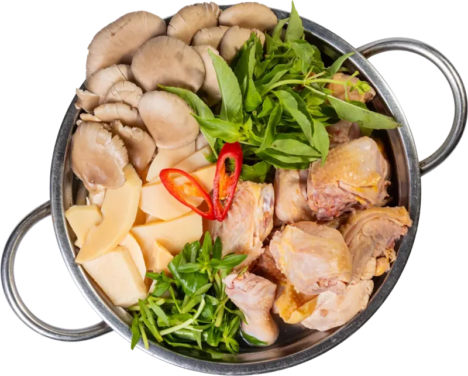

Lẩu gà lá é là món lẩu quen thuộc với khách đến Đà Lạt: nước lẩu nóng, thơm mùi lá é, hợp với trời se lạnh. Ở **Trạm Nắng BBQ & More** (18 Đống Đa), lẩu gà lá é giá **250.000đ**, bạn ăn trên sàn gỗ ngắm thành phố hoặc trong khu trong nhà nếu trời mưa.

## Lá é là gì?

Lá é là một loại rau thơm họ húng, mùi thơm hơi the. Lá được cho vào nồi lẩu gà để tạo mùi đặc trưng của món này.

## Lẩu gà lá é ở Trạm Nắng

- **Giá:** 250.000đ một nồi.
- **Nhóm món:** Signature.
- **Giá mềm nhất** trong các món chính của quán.

## Ăn lúc nào ngon nhất?

Lẩu hợp nhất khi trời đã tối và lạnh. Nhiều bàn gọi món nướng lúc hoàng hôn, rồi gọi lẩu sau 18h30 khi đèn phố đã lên.

## Gọi kèm gì?

| Số người | Gợi ý | Tạm tính |
|---|---|---|
| 2 người | Lẩu gà lá é + chẳng dừng heo + khoai lang phô mai trứng muối | 398.000đ |
| 4 người | Lẩu gà lá é + combo nướng + đậu hũ tắm sốt cay + cơm chiên tỏi trứng | 818.000đ |

*Giá cộng từ thực đơn, chưa gồm đồ uống.*

## Trời mưa có ăn lẩu được không?

Được. Quán có khu trong nhà, nên ngày mưa vẫn ngồi lẩu bình thường. Xem bài [trời mưa Đà Lạt ăn nướng ở đâu](/blog/troi-mua-da-lat-an-nuong-o-dau/).

## Thích cá hơn gà?

Quán có **lẩu cá tầm** giá 360.000đ. Xem đủ món và giá ở trang [Thực đơn](/thuc-don/).

**Trạm Nắng BBQ & More**: 18 Đống Đa, phường Xuân Hương - Đà Lạt · Mở cửa 15h – 22h (order cuối 21h30) · Đặt bàn: [0865 751 768](tel:0865751768)
