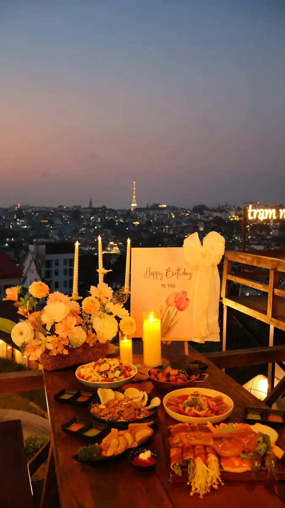
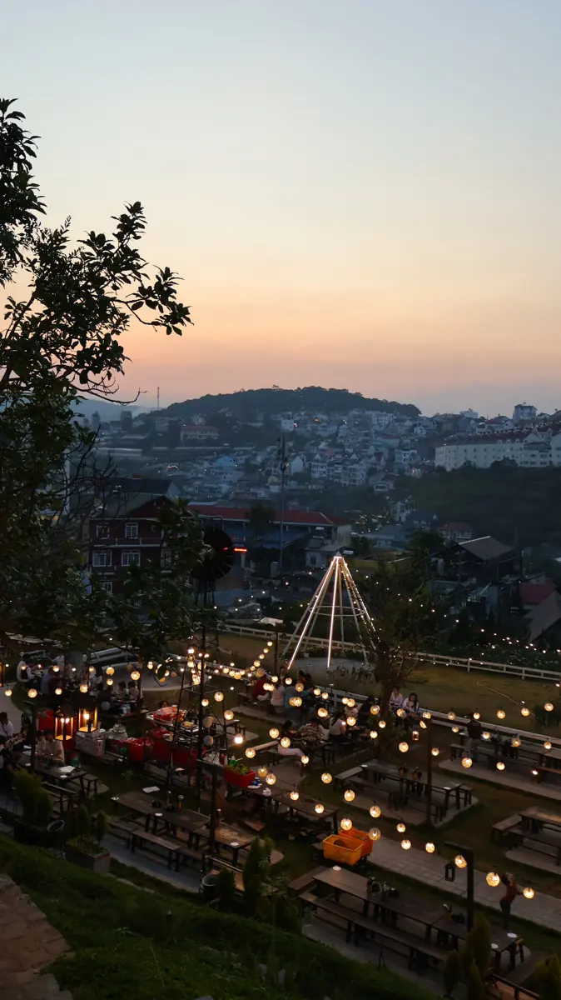

Muốn ngắm Đà Lạt về đêm, bạn cần một chỗ đứng cao hơn khu trung tâm và nhìn về phía có nhiều nhà. Đà Lạt xây trên các triền đồi, nên chỉ cần ở lưng chừng dốc là đã thấy cả một vùng đèn.

## Ba kiểu điểm ngắm Đà Lạt về đêm

| Kiểu điểm ngắm | Ưu điểm | Hạn chế |
|---|---|---|
| Khu trung tâm, quanh hồ và quảng trường | Dễ đi, đông vui | Đứng ngang tầm phố, không thấy toàn cảnh |
| Quán cà phê trên dốc | Thấy được nhiều đèn | Thường chỉ có đồ uống |
| Quán ăn trên cao | Vừa ăn tối vừa ngắm, ngồi được lâu | Nên đặt bàn trước |

## Vừa ăn vừa ngắm ở Trạm Nắng

Trạm Nắng BBQ & More ở 18 Đống Đa thuộc kiểu thứ ba. Sàn gỗ ngoài trời của quán nhìn thẳng ra các đồi nhà trung tâm, tháp Vinaphone sáng đèn phía xa.

Bạn ngồi nướng tại bàn hoặc ăn lẩu, không phải đứng chờ hay chen chỗ chụp hình. Quán mở 15h – 22h mỗi ngày, order cuối 21h30.

## Đẹp nhất lúc nào?

Lúc đẹp nhất là khi trời vừa tối, còn chút màu xanh thẫm mà đèn đã sáng. Khoảng thời gian này kéo dài chừng 20–30 phút sau hoàng hôn.

Nếu đến từ chiều, bạn có cả ba cảnh trong một bữa: nắng chiều, hoàng hôn và phố lên đèn. Xem giờ gợi ý ở bài [quán nướng view hoàng hôn](/blog/quan-nuong-view-hoang-hon-da-lat-di-gio-nao/).

## Mẹo chụp ảnh đêm

- Chụp ngay lúc chập tối, trời còn màu thì ảnh trong hơn.
- Tì điện thoại lên lan can để ảnh không rung.
- Chụp bàn ăn trước, nền phố phía sau sẽ tự thành phông.

Xem thêm hình ở trang [Không gian](/khong-gian/).

**Trạm Nắng BBQ & More**: 18 Đống Đa, phường Xuân Hương - Đà Lạt · Mở cửa 15h – 22h (order cuối 21h30) · Đặt bàn: [0865 751 768](tel:0865751768)
