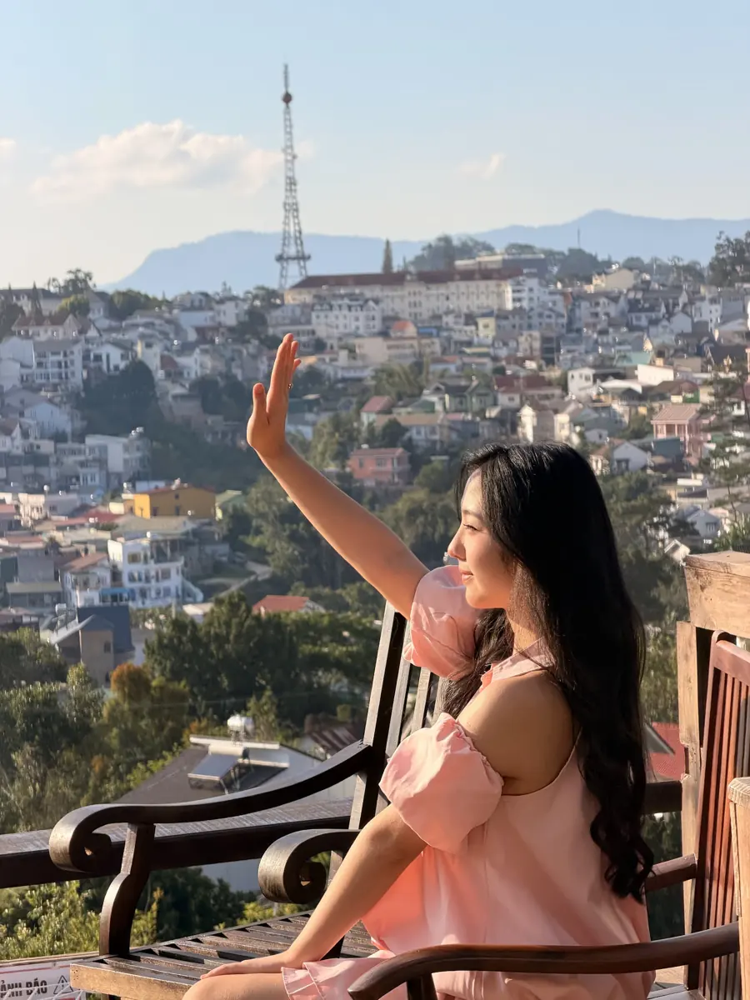
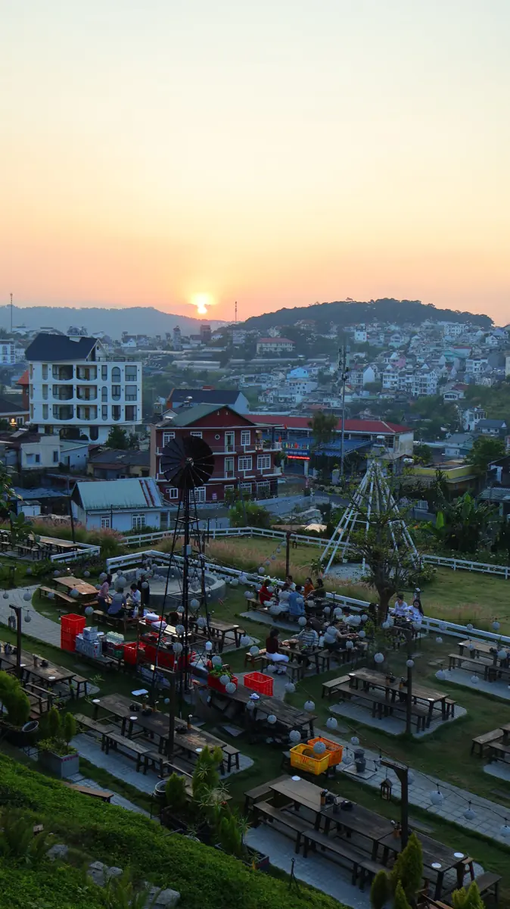
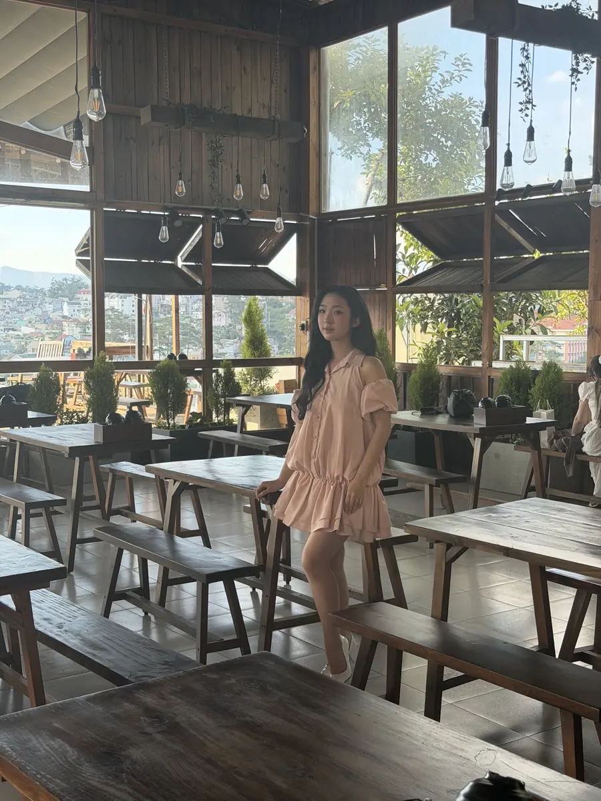
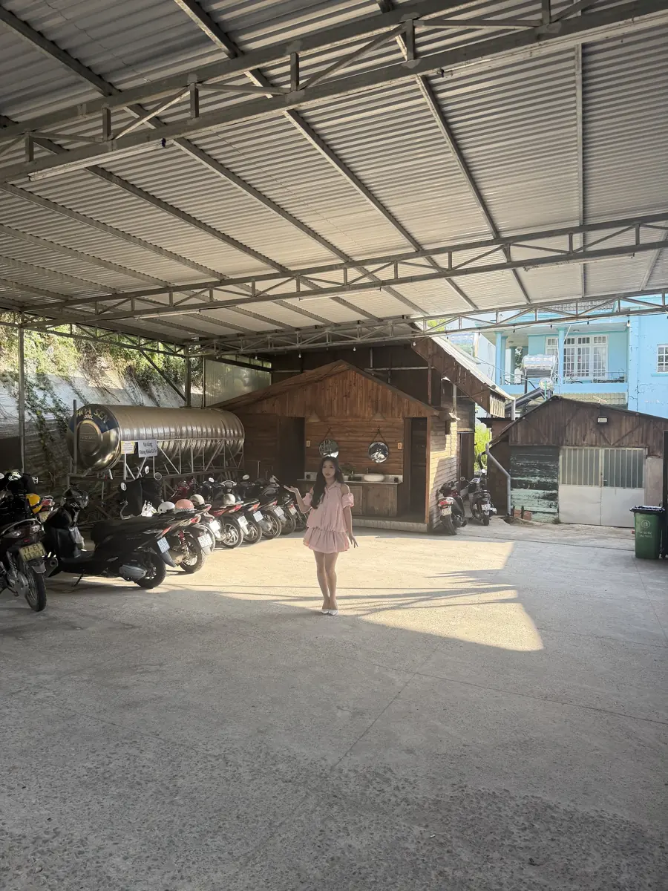

Trạm Nắng có ba khu vực ngồi: **sàn gỗ ngắm phố**, **sân cỏ đèn dây** và **khu trong nhà**. Mỗi khu hợp với một kiểu đi ăn khác nhau. Khi đặt bàn, bạn nói trước muốn ngồi khu nào để quán giữ chỗ.

## So sánh nhanh

| Khu | Hợp với | Điểm mạnh |
|---|---|---|
| Sàn gỗ ngắm phố | Cặp đôi, nhóm nhỏ, tiệc sinh nhật | View tháp Vinaphone và trung tâm Đà Lạt |
| Sân cỏ đèn dây | Nhóm đông, gia đình | Rộng, nhiều bàn, đẹp khi lên đèn |
| Khu trong nhà | Ngày mưa, trời lạnh | Có mái che, ấm hơn ngoài trời |

## Sàn gỗ ngắm phố

Đây là khu cao nhất của quán. Từ đây nhìn thẳng ra tháp Vinaphone và các đồi nhà trung tâm thành phố. Buổi chiều có nền trời hoàng hôn, buổi tối có đèn phố và tháp sáng đèn phía xa.

Bàn tiệc sinh nhật, kỷ niệm thường được dựng ở khu này. Bàn sát lan can nhanh hết vào cuối tuần, nên đặt sớm.

## Sân cỏ đèn dây

Sân cỏ nằm phía dưới sàn gỗ, bàn gỗ đặt rải trên cỏ và giăng đèn dây vàng. Khu này rộng nhất, hợp với nhóm đông và đoàn khách. Đẹp nhất từ lúc chập tối, khi đèn bắt đầu sáng.

Từ tháng 11, sân cỏ được trang trí Giáng sinh. Xem thêm ở bài [Trạm Nắng trang trí Noel](/blog/tram-nang-trang-tri-noel-tu-thang-11/).

## Khu trong nhà

Khu trong nhà có mái che, vách và bàn ghế gỗ. Trời mưa hay quá lạnh, bạn vẫn ngồi nướng bình thường mà không phải bỏ dở bữa.

Hôm nào trời mưa, khu này nhanh kín chỗ, nên nhắn quán trước. Xem thêm ở bài [trời mưa Đà Lạt ăn nướng ở đâu](/blog/troi-mua-da-lat-an-nuong-o-dau/).

## Gửi xe ở đâu?

Quán có bãi đậu xe rộng ngay lối vào.

## Chọn khu theo mục đích

- **Ngắm hoàng hôn, chụp hình:** sàn gỗ, đến trước giờ mặt trời lặn khoảng 45 phút.
- **Sinh nhật, kỷ niệm:** sàn gỗ. Quán trang trí miễn phí theo concept, xem trang [Tiệc sinh nhật](/tiec-sinh-nhat/).
- **Nhóm đông, đoàn khách:** sân cỏ. Quán có sức chứa khoảng 800 khách.
- **Ngày mưa, có người lớn tuổi hoặc trẻ nhỏ:** khu trong nhà.

Xem thêm hình ảnh ở trang [Không gian](/khong-gian/).

**Trạm Nắng BBQ & More**: 18 Đống Đa, phường Xuân Hương - Đà Lạt · Mở cửa 15h – 22h (order cuối 21h30) · Đặt bàn: [0865 751 768](tel:0865751768)
