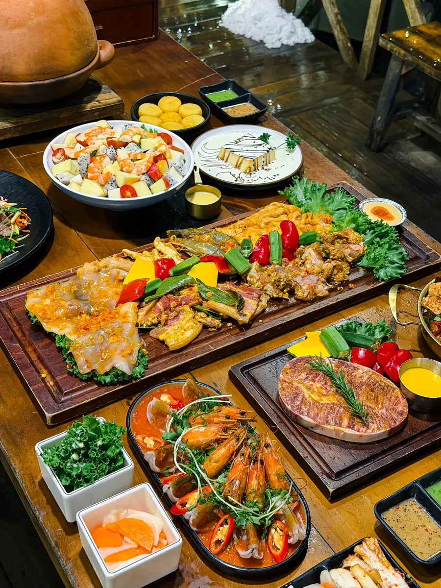

Đi ăn cùng trẻ nhỏ ở Đà Lạt, gia đình thường cần ba thứ: chỗ ngồi rộng, có chỗ tránh mưa lạnh, và món bé ăn được. **Trạm Nắng BBQ & More** ở 18 Đống Đa có sân cỏ rộng, khu trong nhà, và thực đơn có sẵn vài món nhẹ vị cho bé.

## Vì sao hợp với gia đình?

| Nhu cầu | Ở Trạm Nắng |
|---|---|
| Chỗ ngồi rộng | Sân cỏ với nhiều bàn gỗ |
| Tránh mưa, lạnh | Có khu trong nhà |
| Đi lại | Gần trung tâm, bãi đậu xe rộng |
| Giờ ăn sớm | Mở từ 15h, ăn tối sớm được |

## Món dễ ăn cho bé

| Món | Giá |
|---|---|
| Súp gà nấm | 60.000đ |
| Cơm chiên tỏi trứng | 89.000đ |
| Khoai tây chiên giòn rụm | 79.000đ |
| Khoai tây + gà vòng lắc phô mai | 99.000đ |
| Khoai lang phô mai trứng muối | 59.000đ |

Các món có ghi cay trên thực đơn như mực hấp chanh, tôm tái sốt Thái, đậu hũ tắm sốt cay thì nên để phần người lớn.

## Thực đơn gợi ý cho 2 người lớn và 2 bé

Combo nướng + lẩu gà lá é + súp gà nấm + cơm chiên tỏi trứng + khoai tây chiên, tạm tính **868.000đ** chưa gồm đồ uống.

## Lưu ý an toàn khi đi cùng trẻ

1. **Bếp than đặt ngay trên bàn.** Cho bé ngồi phía xa bếp và có người lớn ngồi cạnh.
2. **Sàn gỗ ở trên cao, có lan can.** Trẻ nhỏ cần người trông khi ra khu này.
3. **Mang áo ấm cho bé.** Trời tối lạnh nhanh, nhất là cuối năm.
4. **Đi sớm.** Đến khoảng 16h30 – 17h, bé kịp chơi và ăn xong trước khi trời quá lạnh.

## Nên ngồi khu nào?

- **Sân cỏ:** rộng rãi, hợp với gia đình vào hôm trời đẹp.
- **Khu trong nhà:** khi trời mưa hoặc bé dễ nhiễm lạnh.

Khi đặt bàn, bạn báo trước có trẻ nhỏ để quán xếp chỗ phù hợp. Xem thêm trang [Không gian](/khong-gian/) và [Thực đơn](/thuc-don/).

**Trạm Nắng BBQ & More**: 18 Đống Đa, phường Xuân Hương - Đà Lạt · Mở cửa 15h – 22h (order cuối 21h30) · Đặt bàn: [0865 751 768](tel:0865751768)
