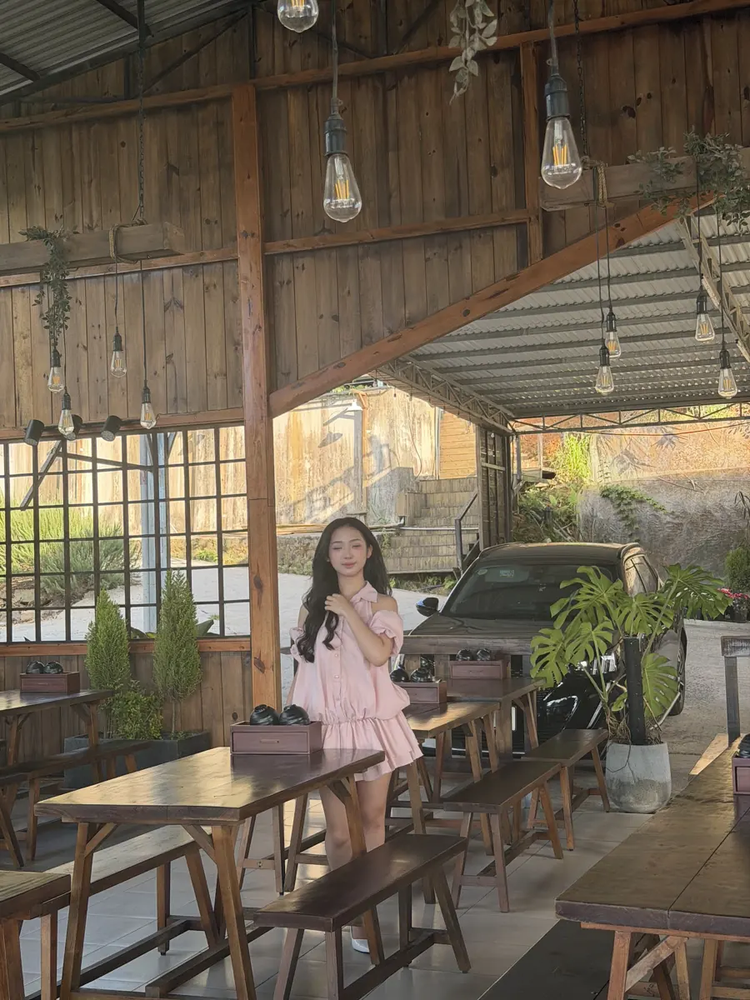

Ăn tối ở khu trung tâm Đà Lạt, khó nhất thường là chỗ gửi xe: đường dốc, hẹp và đông vào cuối tuần. **Trạm Nắng BBQ & More** ở 18 Đống Đa, phường Xuân Hương - Đà Lạt, gần trung tâm và có bãi đậu xe rộng ngay lối vào quán.

## Thông tin nhanh

| Mục | Chi tiết |
|---|---|
| Địa chỉ | 18 Đống Đa, phường Xuân Hương - Đà Lạt |
| Gửi xe | Bãi đậu xe rộng ngay lối vào |
| Giờ mở cửa | 15h – 22h mỗi ngày, order cuối 21h30 |
| Đặt bàn | Điện thoại, Zalo 0865 751 768 |

## Tìm đường đến quán

Cách chắc nhất là mở Google Maps và tìm **"Trạm Nắng BBQ & More"**, hoặc bấm nút **Chỉ đường** ở cuối mỗi trang trên web này. Trang [Liên hệ](/lien-he/) có bản đồ và địa chỉ đầy đủ.

Đường trong khu trung tâm Đà Lạt có nhiều dốc và đường một chiều, nên bạn cứ đi theo chỉ dẫn của bản đồ thay vì tự cắt đường.

## Vì sao nên chọn quán gần trung tâm?

- **Đi lại ngắn.** Từ khách sạn khu trung tâm đến quán không mất nhiều thời gian.
- **Về muộn vẫn tiện.** Ăn xong không phải chạy đường đèo tối.
- **Dễ ghép lịch.** Buổi chiều đi chơi quanh trung tâm, chiều tối ghé quán ngắm hoàng hôn.

## Khu trong nhà của quán

Ngoài sàn gỗ và sân cỏ, quán có khu trong nhà với bàn ghế gỗ dưới mái che.

## Lưu ý khi đi buổi tối và cuối tuần

1. **Đến sớm.** Trước 17h30 dễ gửi xe và chọn bàn hơn.
2. **Đi đoàn nhiều xe** thì nhắn quán trước để được hướng dẫn chỗ đậu.
3. **Trời mưa** không ảnh hưởng: quán có khu trong nhà.

Xem thêm bài [trời mưa Đà Lạt ăn nướng ở đâu](/blog/troi-mua-da-lat-an-nuong-o-dau/) và trang [Không gian](/khong-gian/).

**Trạm Nắng BBQ & More**: 18 Đống Đa, phường Xuân Hương - Đà Lạt · Mở cửa 15h – 22h (order cuối 21h30) · Đặt bàn: [0865 751 768](tel:0865751768)
