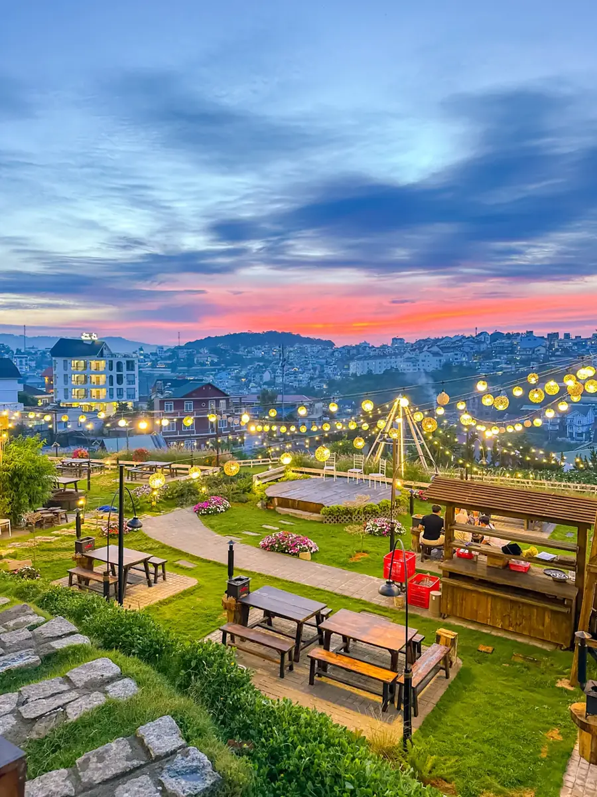

Ăn ngoài trời hợp với Đà Lạt vì không khí mát và có cảnh để nhìn. Điều cần lưu ý là trời tối xuống lạnh nhanh và hay có mưa bất chợt. Vì vậy nên chọn quán ngoài trời có sẵn chỗ ngồi trong nhà để dự phòng, như **Trạm Nắng BBQ & More** ở 18 Đống Đa.

## Hai khu ngoài trời ở Trạm Nắng

| Khu | Đặc điểm | Hợp với |
|---|---|---|
| Sàn gỗ ngắm phố | Trên cao, nhìn ra trung tâm và tháp Vinaphone | Cặp đôi, nhóm nhỏ, tiệc sinh nhật |
| Sân cỏ đèn dây | Rộng, bàn gỗ đặt trên cỏ, giăng đèn | Nhóm đông, gia đình |

## Trời mưa thì sao?

Quán có **khu trong nhà** với mái che và bàn ghế gỗ. Mưa thì chuyển vào, tạnh thì ra lại.

## Ăn ngoài trời ở Đà Lạt cần chuẩn bị gì?

1. **Áo khoác.** Sau 19h nhiệt độ xuống rõ, nhất là từ tháng 11 đến tháng 2.
2. **Đến sớm.** Ngồi từ chiều thì ấm hơn và có hoàng hôn.
3. **Chọn món nóng.** Nướng tại bàn và lẩu giúp cả bàn ấm lên.
4. **Xem dự báo.** Hộp thời tiết trên [trang chủ](/) cho biết hôm nay có mưa không.

## Món hợp với bữa ngoài trời

- Nướng tại bàn: bò tảng sốt trứng muối (189.000đ), tôm nướng muối ớt (129.000đ), ba chỉ heo (89.000đ).
- Lẩu: lẩu gà lá é (250.000đ), lẩu cá tầm (360.000đ).
- Đồ uống: trà nóng (45.000đ), soda các vị (45.000đ).

Xem thêm ảnh từng khu ở trang [Không gian](/khong-gian/) và đủ món ở trang [Thực đơn](/thuc-don/).

**Trạm Nắng BBQ & More**: 18 Đống Đa, phường Xuân Hương - Đà Lạt · Mở cửa 15h – 22h (order cuối 21h30) · Đặt bàn: [0865 751 768](tel:0865751768)
