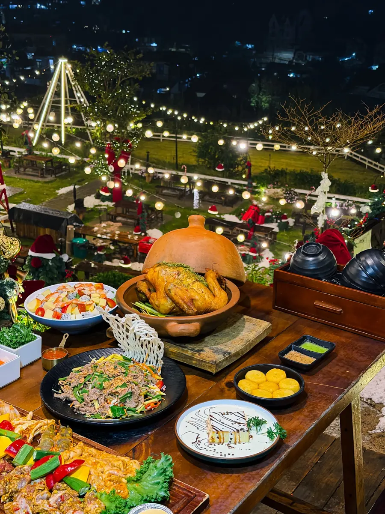
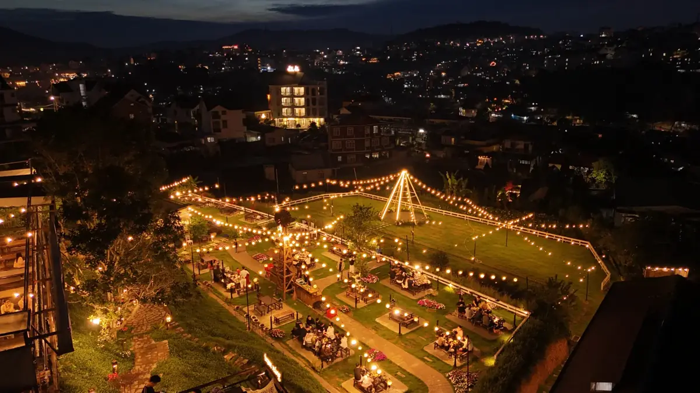

Buổi tối ở Đà Lạt, quán ăn có view đẹp nhất là quán nằm trên cao và nhìn về phía trung tâm, nơi đèn nhà dày nhất. **Trạm Nắng BBQ & More** ở 18 Đống Đa có sàn gỗ ngoài trời nhìn thẳng ra các đồi nhà trung tâm và tháp Vinaphone sáng đèn, mở cửa từ 15h đến 22h mỗi ngày.

## Buổi tối ở Trạm Nắng nhìn thấy gì?

- **Phía xa:** cả một vùng đèn của trung tâm Đà Lạt, tháp Vinaphone nổi lên giữa nền trời.
- **Phía dưới:** sân cỏ của quán giăng đèn dây vàng.
- **Ngay tại bàn:** bếp than hồng và nồi lẩu bốc khói.

## Mấy giờ thì phố lên đèn?

Đèn phố sáng rõ sau khi mặt trời lặn khoảng 20–30 phút. Tùy mùa, đó là quãng 18h đến 18h45.

| Giờ đến | Bạn được gì |
|---|---|
| Trước 17h30 | Kịp cả hoàng hôn lẫn lúc lên đèn |
| 18h30 – 19h30 | Phố vừa lên đèn, đông khách nhất |
| Sau 20h | Vắng hơn, lạnh hơn, hợp ngồi lẩu |

Quán nhận order cuối lúc 21h30, nên muốn ngồi thong thả thì đến trước 20h.

## Buổi tối nên gọi gì?

- **Nướng tại bàn:** bò tảng sốt trứng muối (189.000đ), ba chỉ bò (129.000đ), chẳng dừng heo (89.000đ).
- **Lẩu cho trời lạnh:** lẩu gà lá é (250.000đ), lẩu cá tầm (360.000đ).
- **Đồ uống ấm:** trà nóng cam quế hoặc gừng táo đỏ (45.000đ).

Xem đủ món ở trang [Thực đơn](/thuc-don/).

## Lưu ý khi đi buổi tối

1. **Mang áo khoác.** Ngồi ngoài trời sau 19h khá lạnh.
2. **Đặt bàn trước** nếu muốn ngồi sát lan can, nhất là cuối tuần.
3. **Trời mưa** thì chuyển vào khu trong nhà.

Muốn đến sớm hơn để ngắm hoàng hôn, xem bài [đi giờ nào để kịp trời tím hồng](/blog/quan-nuong-view-hoang-hon-da-lat-di-gio-nao/).

**Trạm Nắng BBQ & More**: 18 Đống Đa, phường Xuân Hương - Đà Lạt · Mở cửa 15h – 22h (order cuối 21h30) · Đặt bàn: [0865 751 768](tel:0865751768)
