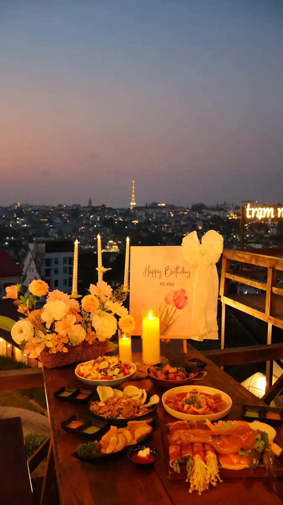

Một buổi hẹn hò ở Đà Lạt cần chỗ ngồi yên, có cảnh đẹp và ngồi được lâu. Sàn gỗ ngoài trời của **Trạm Nắng BBQ & More** nhìn thẳng ra trung tâm thành phố: chiều có hoàng hôn, tối có đèn phố và tháp Vinaphone sáng đèn.

## Vì sao hợp với cặp đôi?

- **Bàn sát lan can** nhìn ra thành phố, ngồi hai người vừa vặn.
- **Nướng tại bàn** là kiểu ăn chậm, có việc để cùng làm.
- **Decor miễn phí** cho sinh nhật và kỷ niệm, quán hỗ trợ đặt bánh và hoa.

## Lịch một buổi hẹn gợi ý

| Giờ | Làm gì |
|---|---|
| Trước hoàng hôn 45 phút | Đến quán, chọn bàn, gọi món nướng |
| Lúc hoàng hôn | Chụp ảnh với nền trời đổi màu |
| Sau 18h30 | Gọi lẩu hoặc trà nóng, ngắm phố lên đèn |
| Trước 21h30 | Gọi món cuối, quán đóng cửa lúc 22h |

Giờ hoàng hôn thay đổi theo mùa, khoảng 17h20 đến 18h20.

## Thực đơn cho hai người

| Kiểu | Món | Tạm tính |
|---|---|---|
| Gọn nhẹ | Combo nướng + khoai lang phô mai trứng muối + 2 soda | 539.000đ |
| Đủ đầy | Bò tảng sốt trứng muối + tôm nướng muối ớt + lẩu gà lá é + 2 trà nóng | 658.000đ |

*Giá cộng từ thực đơn.*

## Muốn có bất ngờ?

Nếu là sinh nhật hoặc ngày kỷ niệm, bạn nhắn quán trước qua Zalo 0865 751 768. Quán trang trí bàn miễn phí theo concept và hỗ trợ đặt bánh, hoa. Xem trang [Tiệc sinh nhật](/tiec-sinh-nhat/).

## Mẹo nhỏ

1. Đặt bàn trước và nói rõ muốn ngồi **sàn gỗ, sát lan can**.
2. Mang áo khoác cho cả hai, tối ngoài trời lạnh.
3. Trời mưa thì chuyển vào khu trong nhà.

Xem thêm ảnh ở trang [Không gian](/khong-gian/).

**Trạm Nắng BBQ & More**: 18 Đống Đa, phường Xuân Hương - Đà Lạt · Mở cửa 15h – 22h (order cuối 21h30) · Đặt bàn: [0865 751 768](tel:0865751768)
