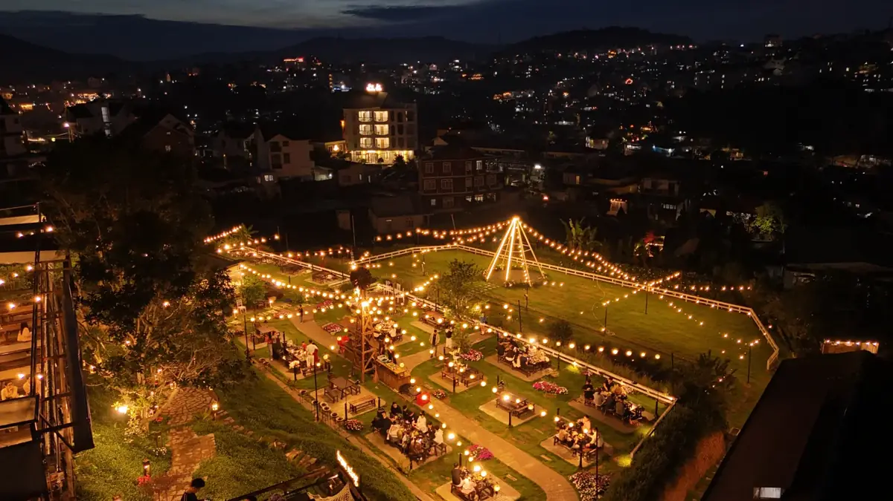
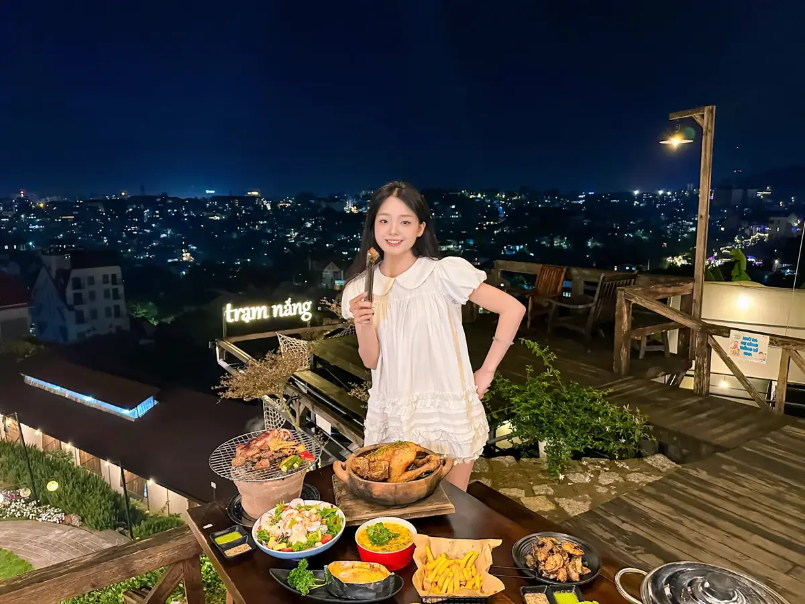

Một quán nướng Đà Lạt có view đẹp cần ba thứ: nằm trên cao, nhìn ra phía có đèn thành phố, và có chỗ ngồi ngoài trời đủ gần lan can. **Trạm Nắng BBQ & More** ở 18 Đống Đa đáp ứng cả ba, với sàn gỗ nhìn thẳng ra tháp Vinaphone và trung tâm thành phố. Dưới đây là 5 tiêu chí để bạn tự chọn quán, kèm trải nghiệm cụ thể ở Trạm Nắng.

## 5 tiêu chí chọn quán nướng có view đẹp ở Đà Lạt

| Tiêu chí | Nên hỏi quán điều gì | Ở Trạm Nắng |
|---|---|---|
| Hướng nhìn | Từ bàn ăn thấy gì: đồi thông, thung lũng hay thành phố? | Tháp Vinaphone và các đồi nhà trung tâm |
| Giờ đẹp | Quán mở từ mấy giờ, có kịp hoàng hôn không? | Mở 15h – 22h, kịp cả hoàng hôn lẫn phố lên đèn |
| Khi trời mưa | Có chỗ ngồi trong nhà không? | Có khu trong nhà |
| Đi lại, đậu xe | Cách trung tâm bao xa, có bãi xe không? | Gần trung tâm, bãi đậu xe rộng |
| Giá | Món nướng từ bao nhiêu, có combo không? | Nướng tại bàn từ 79.000đ, combo 2–3 người 390.000đ |

## View ở Trạm Nắng nhìn thấy gì?

Từ sàn gỗ ngoài trời, bạn nhìn thẳng ra tháp Vinaphone và các đồi nhà trung tâm Đà Lạt. Phía dưới là sân cỏ giăng đèn dây của quán.

Quán có ba khu vực ngồi, mỗi khu một góc nhìn khác nhau. Xem so sánh ở bài [ngồi khu nào ở Trạm Nắng](/blog/ngoi-khu-nao-o-tram-nang-san-go-san-co-trong-nha/) hoặc trang [Không gian](/khong-gian/).

## Giờ nào view đẹp nhất?

View đẹp nhất vào khoảng 15–20 phút sau khi mặt trời lặn, lúc trời còn màu và đèn phố vừa sáng.

| Khung giờ | Bạn thấy gì | Hợp với |
|---|---|---|
| 15h – 17h | Thành phố rõ nét dưới nắng chiều | Chụp ảnh toàn cảnh, ngồi thong thả |
| Quanh giờ hoàng hôn | Trời chuyển cam, tím hồng | Chụp ảnh người, hẹn hò |
| Sau 18h30 | Phố lên đèn, tháp sáng đèn, sân cỏ giăng đèn dây | Ăn lẩu, tiệc sinh nhật, nhóm đông |

Mặt trời ở Đà Lạt lặn trong khoảng 17h20 – 18h20 tùy mùa. Nên đến trước giờ đó khoảng 45 phút. Bảng giờ theo từng mùa có trong bài [đi giờ nào để kịp trời tím hồng](/blog/quan-nuong-view-hoang-hon-da-lat-di-gio-nao/).

## Ngồi ngắm view thì gọi món gì?

Nướng tại bàn ăn chậm và ngồi lâu, nên hợp với việc vừa ăn vừa ngắm trời đổi màu.

- **Lúc hoàng hôn:** combo nướng cho 2–3 người (390.000đ) hoặc bò tảng sốt trứng muối (189.000đ).
- **Khi trời tối và lạnh hơn:** lẩu gà lá é (250.000đ) hoặc lẩu cá tầm (360.000đ).
- **Ăn chơi trong lúc chờ:** đậu hũ tắm sốt cay (89.000đ), khoai lang phô mai trứng muối (59.000đ).
- **Đồ uống ấm:** trà nóng cam quế hoặc gừng táo đỏ (45.000đ).

Xem đủ món và giá ở trang [Thực đơn](/thuc-don/).

## Đi 2 người, 4 người hết khoảng bao nhiêu?

| Nhóm | Gợi ý | Tạm tính |
|---|---|---|
| 2 người | Combo nướng + khoai lang phô mai trứng muối + 2 soda | 539.000đ |
| 4 người | Combo nướng + lẩu gà lá é + bò tảng sốt trứng muối + đậu hũ tắm sốt cay | 918.000đ |

*Giá cộng từ thực đơn. Dòng 4 người chưa gồm đồ uống.*

## Mẹo để có bàn view đẹp

1. **Đặt bàn trước** và nói rõ muốn ngồi sàn gỗ sát lan can. Cuối tuần chỗ này nhanh hết.
2. **Đến sớm hơn giờ hoàng hôn 45 phút** để kịp gọi món và nhóm bếp.
3. **Mang áo khoác.** Ngồi ngoài trời sau 19h ở Đà Lạt khá lạnh.
4. **Trời mưa vẫn đi được.** Quán có khu trong nhà, tạnh mưa thì ra lại sàn gỗ.

**Trạm Nắng BBQ & More**: 18 Đống Đa, phường Xuân Hương - Đà Lạt · Mở cửa 15h – 22h (order cuối 21h30) · Đặt bàn: [0865 751 768](tel:0865751768)
