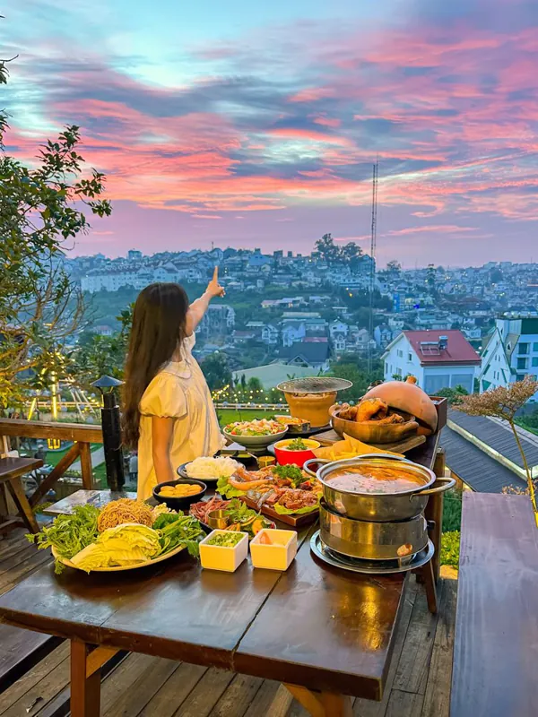
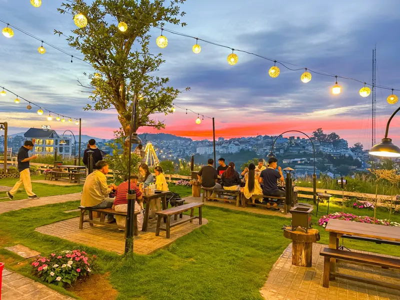

Ở Trạm Nắng, khoảnh khắc đáng chờ nhất là lúc trời chuyển từ cam sang tím hồng phía trên các đồi nhà Đà Lạt, rồi cả thành phố lên đèn. Muốn ngồi đúng chỗ, đúng giờ thì cần tính trước một chút.

## Mấy giờ mặt trời lặn ở Đà Lạt?

Giờ lặn thay đổi theo mùa, nhưng không chênh nhiều:

| Thời gian trong năm | Mặt trời lặn khoảng |
|---|---|
| Tháng 11 – tháng 1 | 17h20 – 17h40 |
| Tháng 2 – tháng 4 | 17h40 – 18h00 |
| Tháng 5 – tháng 8 | 18h00 – 18h20 |
| Tháng 9 – tháng 10 | 17h30 – 17h50 |

Trời đẹp nhất thường là **15–20 phút sau khi mặt trời lặn**, khi mây bắt màu hồng tím và đèn trong phố bắt đầu sáng.

## Nên đến lúc mấy giờ?

**Đến trước giờ mặt trời lặn khoảng 45 phút.** Đủ thời gian chọn chỗ, gọi món và nhóm bếp than, để lúc trời đổi màu bạn đã ngồi yên với miếng nướng đầu tiên.

- Mùa cuối năm: đến khoảng **16h30 – 16h45**.
- Mùa hè: đến khoảng **17h15 – 17h30**.

Trạm Nắng mở cửa **15h – 22h** hằng ngày, nhận order cuối lúc **21h30**, nên đến sớm ngồi chờ hoàng hôn cũng được.

## Tháng nào hoàng hôn đẹp?

- **Mùa khô (khoảng tháng 12 đến tháng 4):** trời trong, ít mưa chiều, nhiều ngày có hoàng hôn rực.
- **Mùa mưa (khoảng tháng 5 đến tháng 10):** chiều hay có mưa, nhưng sau cơn mưa trời thường rất trong và mây đẹp. Nên xem dự báo trước khi đi.

## Mẹo để có bàn và ảnh đẹp

1. **Đặt bàn trước**, nhất là cuối tuần và lễ. Bàn sát lan can nhìn ra phố nhanh hết.
2. **Mang áo khoác.** Đà Lạt xuống nhiệt nhanh sau khi trời tối, ngồi ngoài trời sẽ lạnh.
3. **Chụp ngược sáng trước, chụp món sau.** Lúc trời còn sáng thì chụp người với nền trời. Khi đèn dây sáng lên thì chụp bàn ăn.
4. **Gọi lẩu cho lúc trời tối.** Món nướng ăn lúc hoàng hôn, nồi lẩu nóng để dành cho lúc trời lạnh.

Chưa biết gọi gì? Xem bài [10 món nên gọi lần đầu ở Trạm Nắng](/blog/an-gi-o-tram-nang-mon-nen-goi-lan-dau/) hoặc trang [Thực đơn](/thuc-don/).

**Trạm Nắng BBQ & More**: 18 Đống Đa, phường Xuân Hương - Đà Lạt · [Xem đường đi trên Google Maps](https://www.google.com/maps/place/tr%E1%BA%A1m+n%E1%BA%AFng/data=!4m2!3m1!1s0x31711344fbf5174d:0xfd28f063bc80da8c) · Mở cửa 15h – 22h (order cuối 21h30) · Đặt bàn: [0865 751 768](tel:0865751768)
