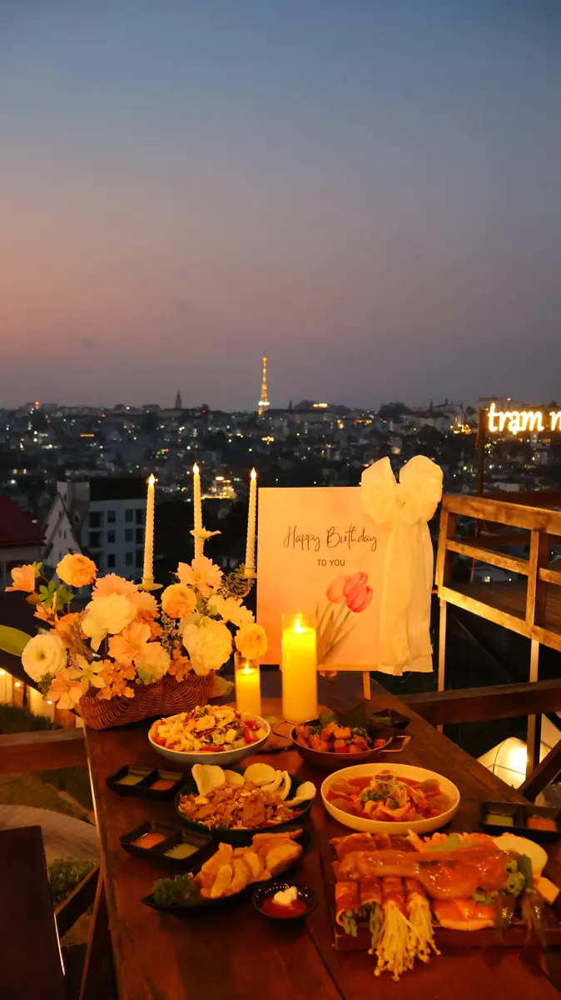

Tháp Vinaphone là cột tháp cao ở khu trung tâm, dễ nhận ra trong nhiều tấm ảnh chụp toàn cảnh Đà Lạt. Muốn ngồi ăn mà nhìn thẳng ra tháp, bạn đến **Trạm Nắng BBQ & More** ở 18 Đống Đa: sàn gỗ ngoài trời của quán hướng về phía tháp và các đồi nhà trung tâm.

## Ngồi đâu để thấy tháp rõ nhất?

Chọn **sàn gỗ ngắm phố**, các bàn sát lan can. Từ đây tháp nằm ngay giữa khung hình, phía dưới là các lớp mái nhà.

## Tháp đẹp nhất vào giờ nào?

| Thời điểm | Cảnh | Gợi ý chụp |
|---|---|---|
| Buổi chiều | Tháp rõ nét trên nền trời xanh | Chụp toàn cảnh thành phố |
| Hoàng hôn | Tháp in bóng trên nền trời cam, hồng | Chụp người đứng cạnh lan can |
| Buổi tối | Tháp sáng đèn giữa vùng đèn phố | Chụp bàn ăn, lấy tháp làm nền |

## Đặt bàn view tháp thế nào?

1. Gọi hoặc nhắn Zalo **0865 751 768**.
2. Nói rõ: muốn ngồi sàn gỗ, bàn sát lan can, nhìn ra tháp.
3. Báo số người và giờ đến.

Cuối tuần các bàn này hết sớm, nên đặt trước một hai ngày.

## Kết hợp tiệc sinh nhật

Bàn tiệc sinh nhật, kỷ niệm thường được dựng ở khu sàn gỗ, nên ảnh tiệc có luôn tháp và thành phố phía sau. Quán trang trí miễn phí theo concept, xem trang [Tiệc sinh nhật](/tiec-sinh-nhat/).

Xem thêm ảnh ở trang [Không gian](/khong-gian/) và bài [quán nướng Đà Lạt có view đẹp](/blog/quan-nuong-da-lat-co-view-dep/).

**Trạm Nắng BBQ & More**: 18 Đống Đa, phường Xuân Hương - Đà Lạt · Mở cửa 15h – 22h (order cuối 21h30) · Đặt bàn: [0865 751 768](tel:0865751768)
