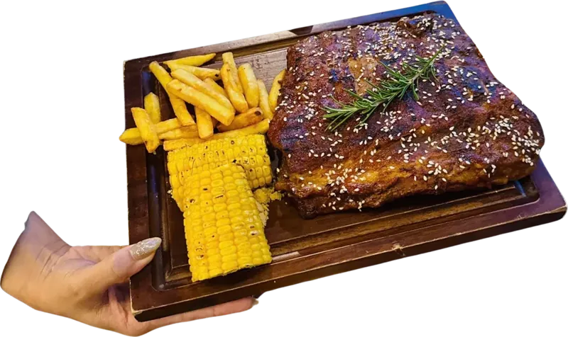

Nếu bạn tìm sườn nướng ở Đà Lạt cho cả nhóm cùng ăn, món nên thử ở **Trạm Nắng BBQ & More** là **sườn tảng đút lò**: nguyên một tảng sườn heo, giá **369.000đ**, gắn nhãn best seller trong nhóm Signature.

## Sườn tảng đút lò có gì?

- **Nguyên tảng sườn heo**, mang ra trên thớt gỗ.
- **Ăn kèm** khoai tây chiên và bắp.
- **Giá:** 369.000đ một tảng.

Đây là món đã làm chín sẵn, khác với các món nướng tại bàn mà bạn tự nướng trên bếp than.

## Một tảng ăn mấy người?

Ước chừng một tảng hợp với **3–4 người** khi gọi kèm món khác. Vì là món mang ra nguyên tảng, nhiều bàn chọn sườn làm món chính giữa bàn rồi gọi thêm món nướng nhỏ xung quanh.

## Nên gọi thêm gì?

| Mục đích | Món | Giá |
|---|---|---|
| Thêm món nước | Lẩu gà lá é | 250.000đ |
| Tự nướng tại bàn | Chẳng dừng heo | 89.000đ |
| Cân vị, thêm rau | Salad dầu giấm | 79.000đ |
| Ăn chơi | Khoai lang phô mai trứng muối | 59.000đ |

Ví dụ cho 4 người: sườn tảng đút lò + lẩu gà lá é + chẳng dừng heo + salad dầu giấm, tạm tính **787.000đ** chưa gồm đồ uống.

## Thích sườn thì còn món nào?

Trong **combo nướng** cho 2–3 người (390.000đ) cũng có sườn, cùng gà, tôm và rau củ. Combo hợp với nhóm nhỏ muốn thử nhiều thứ trong một khay.

## Đi đông thì gọi thế nào?

Nhóm 6 người có thể gọi: gà Kampot + sườn tảng đút lò + lẩu cá tầm + chẳng dừng heo + nầm nướng chao + cơm chiên tỏi trứng, tạm tính **1.366.000đ**.

Xem đủ món ở trang [Thực đơn](/thuc-don/#signature) và bài [10 món nên gọi lần đầu](/blog/an-gi-o-tram-nang-mon-nen-goi-lan-dau/).

**Trạm Nắng BBQ & More**: 18 Đống Đa, phường Xuân Hương - Đà Lạt · Mở cửa 15h – 22h (order cuối 21h30) · Đặt bàn: [0865 751 768](tel:0865751768)
