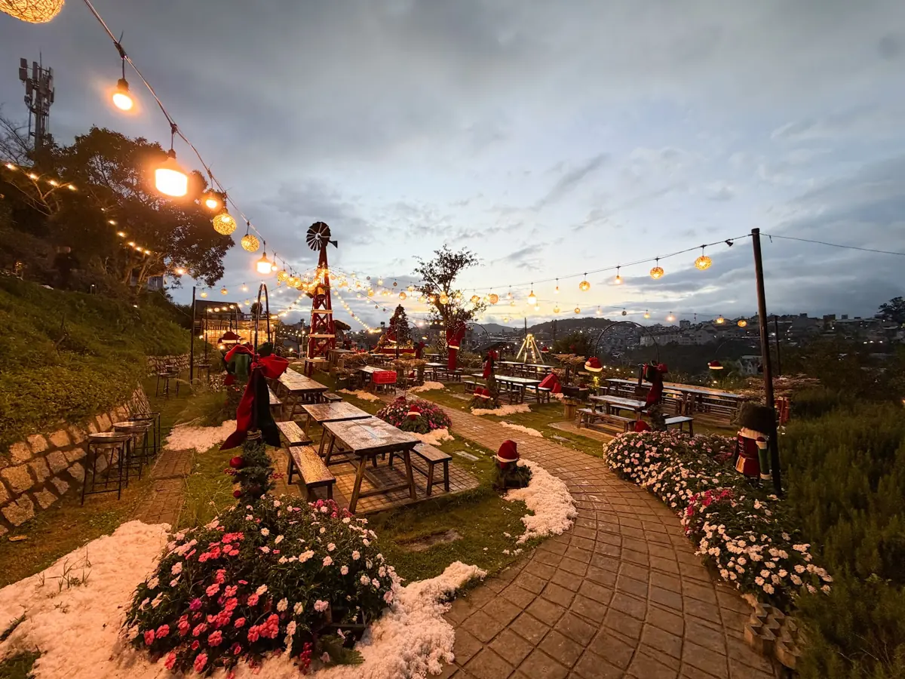

Tất niên công ty cần một chỗ đủ rộng, dễ đi và có không khí cuối năm. **Trạm Nắng BBQ & More** ở 18 Đống Đa nhận đoàn đông với sức chứa khoảng 800 khách, sân cỏ giăng đèn dây và khu trong nhà dự phòng khi trời mưa.

## Vì sao hợp làm tất niên?

| Tiêu chí | Ở Trạm Nắng |
|---|---|
| Sức chứa | Khoảng 800 khách |
| Không gian | Sân cỏ đèn dây, sàn gỗ ngắm phố, khu trong nhà |
| Không khí cuối năm | Quán trang trí Giáng sinh từ tháng 11 |
| Kiểu ăn | Nướng tại bàn, lẩu, hợp ngồi lâu trò chuyện |
| Đi lại | Gần trung tâm, bãi đậu xe rộng |

## Gợi ý thực đơn theo bàn 6 người

| Mức | Món | Tạm tính mỗi bàn |
|---|---|---|
| Gọn | Combo nướng + lẩu gà lá é + ba chỉ heo + chẳng dừng heo + rau củ kho quẹt + cơm chiên tỏi trứng | 996.000đ |
| Đầy đủ | Gà Kampot + sườn tảng đút lò + lẩu cá tầm + chẳng dừng heo + nầm nướng chao + cơm chiên tỏi trứng | 1.366.000đ |

*Giá cộng từ thực đơn, chưa gồm đồ uống.*

## Đồ uống cho tiệc

| Loại | Giá |
|---|---|
| Bia Tiger Bạc (chai nhí) | 23.000đ |
| Bia Ken Bạc | 28.000đ |
| Soju | 99.000đ |
| Rượu nếp mới | 140.000đ |
| Nước ngọt | 20.000đ |

## Các bước đặt tiệc

1. **Nhắn Zalo 0865 751 768** càng sớm càng tốt: số khách, ngày giờ, ngân sách dự kiến.
2. **Chọn khu ngồi.** Đoàn đông thường ngồi sân cỏ, có phương án vào khu trong nhà nếu mưa.
3. **Chốt thực đơn trước** để bếp chuẩn bị.
4. **Báo các yêu cầu riêng** như chỗ phát biểu, chỗ chụp ảnh tập thể để quán tư vấn.

## Lưu ý

- Tháng 12 và tháng 1 là mùa cao điểm, lịch cuối tuần kín sớm.
- Quán mở 15h – 22h, order cuối 21h30, nên tiệc nên bắt đầu trước 18h30.
- Buổi tối ngoài trời lạnh, nhắc mọi người mang áo khoác.

Xem thêm bài [quán trang trí Noel từ tháng 11](/blog/tram-nang-trang-tri-noel-tu-thang-11/) và trang [Liên hệ](/lien-he/).

**Trạm Nắng BBQ & More**: 18 Đống Đa, phường Xuân Hương - Đà Lạt · Mở cửa 15h – 22h (order cuối 21h30) · Đặt bàn: [0865 751 768](tel:0865751768)
