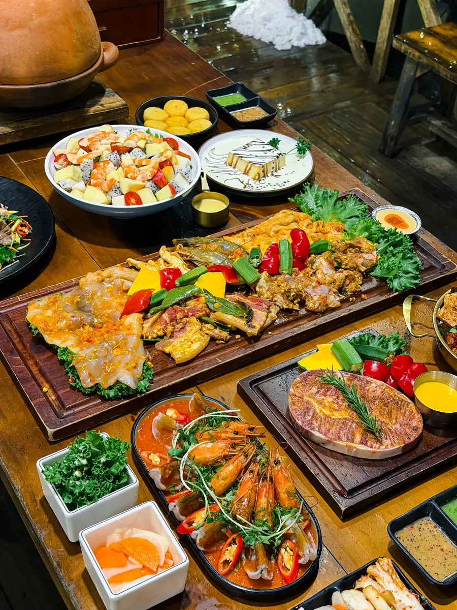

**Trạm Nắng BBQ & More** là quán nướng, lẩu ngoài trời ở 18 Đống Đa, Đà Lạt. Món nướng tại bàn giá từ **79.000đ đến 189.000đ**, lẩu từ **250.000đ đến 360.000đ**, combo nướng cho 2–3 người **390.000đ**. Tính ra, một bữa tối rơi vào khoảng 230.000đ – 330.000đ mỗi người.

## Mức giá theo từng nhóm món

| Nhóm món | Số món | Khoảng giá |
|---|---|---|
| Signature (món chính) | 5 | 250.000đ – 390.000đ |
| BBQ tại bàn | 12 | 79.000đ – 189.000đ |
| Khai vị | 5 | 60.000đ – 155.000đ |
| Món ăn chơi | 13 | 50.000đ – 169.000đ |
| Cơm và mì | 4 | 89.000đ – 110.000đ |
| Đồ uống | 10 | 15.000đ – 140.000đ |

## Giá 5 món Signature

| Món | Giá |
|---|---|
| Combo nướng (2–3 người) | 390.000đ |
| Sườn tảng đút lò | 369.000đ |
| Lẩu cá tầm | 360.000đ |
| Gà Kampot (nguyên con) | 350.000đ |
| Lẩu gà lá é | 250.000đ |

## Các món best seller

- Gà Kampot – 350.000đ
- Sườn tảng đút lò – 369.000đ
- Bò tảng sốt trứng muối – 189.000đ
- Nầm nướng chao – 109.000đ
- Chẳng dừng heo – 89.000đ
- Sứa sốt Namjim – 89.000đ
- Đậu hũ tắm sốt cay – 89.000đ
- Cơm chiên tỏi trứng – 89.000đ
- Khoai lang phô mai trứng muối – 59.000đ

## Đi mấy người thì hết bao nhiêu?

| Nhóm | Gợi ý | Tạm tính |
|---|---|---|
| 2 người | Combo nướng + khoai lang phô mai trứng muối + 2 soda | 539.000đ |
| 4 người | Combo nướng + lẩu gà lá é + bò tảng sốt trứng muối + đậu hũ tắm sốt cay | 918.000đ |
| 6 người | Gà Kampot + sườn tảng đút lò + lẩu cá tầm + chẳng dừng heo + nầm nướng chao + cơm chiên tỏi trứng | 1.366.000đ |

*Dòng 4 và 6 người chưa gồm đồ uống.*

## Thông tin khác hay được hỏi

| Câu hỏi | Trả lời |
|---|---|
| Giờ mở cửa | 15h – 22h mỗi ngày, order cuối 21h30 |
| Thanh toán | Tiền mặt, chuyển khoản |
| Decor sinh nhật, kỷ niệm | Miễn phí, theo concept của quán |
| Trời mưa | Có khu trong nhà |
| Gửi xe | Bãi đậu xe rộng |
| Đặt bàn | Điện thoại, Zalo 0865 751 768 |

Giá có thể được quán điều chỉnh theo thời gian. Bảng giá mới nhất luôn có ở trang [Thực đơn](/thuc-don/).

**Trạm Nắng BBQ & More**: 18 Đống Đa, phường Xuân Hương - Đà Lạt · Mở cửa 15h – 22h (order cuối 21h30) · Đặt bàn: [0865 751 768](tel:0865751768)
