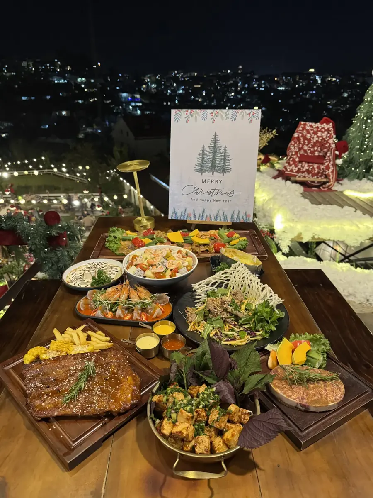
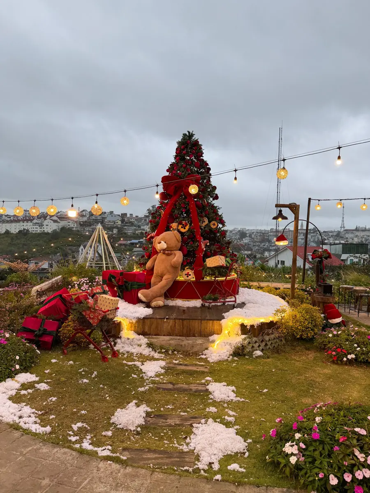
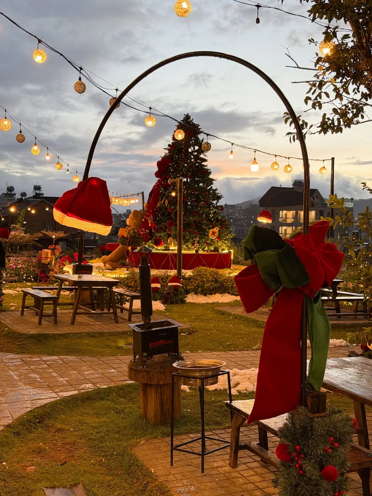

Đà Lạt cuối năm vốn đã lạnh và nhiều sương, rất hợp không khí Giáng sinh. Ở Trạm Nắng, mùa Noel bắt đầu sớm: **từ tháng 11 quán đã trang trí xong**, nên bạn không cần đợi sát ngày 24/12 mới có góc chụp hình Noel.

## Noel ở Trạm Nắng có gì?

- **Sân cỏ giăng đèn dây** vàng ấm, lên đèn từ lúc chập tối.
- **Cây thông, ông già Noel và hộp quà** đặt dọc lối đi và quanh các bàn.
- **Tuyết nhân tạo** rơi trên sân cỏ, lên hình rất rõ khi trời vừa tối.
- **Bàn tiệc trang trí Noel** với cành thông, quả châu và bảng Merry Christmas, phía sau là thành phố lên đèn.

## Đi giờ nào đẹp?

Có hai khung giờ đáng đi:

1. **Trước hoàng hôn khoảng 45 phút.** Bạn kịp chụp nền trời tím hồng, rồi ngồi luôn tới lúc đèn Noel sáng lên.
2. **Sau 18h30.** Trời tối hẳn, đèn dây và tuyết nhân tạo nổi nhất. Lúc này nên gọi lẩu vì Đà Lạt tháng 11, tháng 12 về đêm khá lạnh.

Quán mở cửa **15h – 22h** hằng ngày, nhận order cuối lúc 21h30.

## Gọi món gì cho bữa Noel?

Nhóm 4 người có thể gọi **Combo nướng** (390.000đ), **Lẩu gà lá é** (250.000đ), **Bò tảng sốt trứng muối** (189.000đ) và **Đậu hũ tắm sốt cay** (89.000đ), tạm tính 918.000đ chưa gồm đồ uống. Xem đủ món ở trang [Thực đơn](/thuc-don/).

## Lưu ý khi đi mùa lễ

- **Đặt bàn trước**, nhất là tối cuối tuần và tuần sát Giáng sinh.
- **Mang áo khoác.** Ngồi ngoài trời sau 19h sẽ lạnh.
- **Trời mưa vẫn đi được.** Quán có khu trong nhà.
- Muốn tổ chức sinh nhật hay kỷ niệm trong mùa Noel, xem thêm trang [Tiệc sinh nhật](/tiec-sinh-nhat/).

**Trạm Nắng BBQ & More**: 18 Đống Đa, phường Xuân Hương - Đà Lạt · Mở cửa 15h – 22h (order cuối 21h30) · Đặt bàn: [0865 751 768](tel:0865751768)
